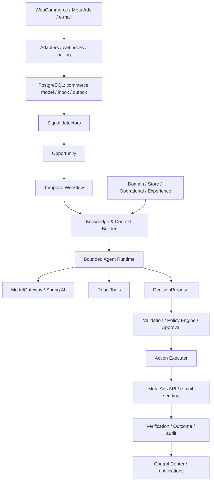

# Autonomous E-commerce Operator — product concept and MVP architecture

Version: 1.2 · Date: 14 November 2026 · Status: draft for review

The parent document for the product scope. Technical details are in the [AI architecture](02-AI-AGENT-ARCHITECTURE.md), the reference implementation in [Inventory Guardian end-to-end](03-INVENTORY-GUARDIAN-E2E.md), and the views and frontend–backend contracts in the [UI/UX specification](04-UI-UX-SPECIFICATION.md). Recommended reading order: product → AI → process → UI.

## 1. Basis and how to read

The basis is the conversation "E-commerce agent brainstorming", identifier `6af84827-e08c-83ed-a972-76644325952c`, and the current request for three documents. Four available turns were read, including the earlier brainstorming and the choice of DTC. The tool returned two longer assistant answers cut to 20,000 characters each; we do not treat their invisible endings as known findings. Unavailable values of former sliders and switches are not a policy configuration.

Update 1.1 takes into account the user's new decisions about the MVP, analytics, Customer Support and UI/UX, and five available turns of the further conversation. Two answers from that part of the read are cut; we do not treat the missing parts as known findings. The user's current instruction is the basis for scope changes.

Update 1.2 adds Business Knowledge & Decision Intelligence based on the current instruction and the full available answer about the four knowledge sources from the further conversation. The details are gathered in [05 — Decision Intelligence Architecture](05-DECISION-INTELLIGENCE-ARCHITECTURE.md).

All five files use a common legend:

| Marker | Meaning |
|---|---|
| **[D] Decision** | A direction chosen by the user or adopted in the current documentation request. |
| **[U] Agreed direction** | A concrete proposal from the conversation adopted as the basis of the design, without implying formal approval of every detail. |
| **[P] Proposal** | A design refinement added in this package; it needs review before implementation. |
| **[Z] Assumption** | A market hypothesis, sample data, limits or a parameter to validate. |
| **[O] Open question** | A resolution needed for implementation or the next phase. |

If a section has a marker, it applies to its content unless stated otherwise. The common identifiers `D-*`, `U-*`, `P-*`, `Z-*`, `O-*` make decisions easier to trace. The documents are a design, not a statement of an existing implementation. External sources explain the capabilities of technologies; they do not prove market needs or product effectiveness.

## 2. Product vision and value [D, U]

**D-01:** The first segment is small and medium DTC stores. Autonomous E-commerce Operator works in the background: it observes the store, detects problems and opportunities, prepares decisions, carries out allowed actions and checks the result. Conversation with the agent is a supporting interface. The core processes are triggered by events and schedules.

**D-04:** We support existing stores only. Creating a store, generating a storefront and launching it stay outside the MVP. Onboarding means connecting sources, configuring data and policies and starting monitoring.

**D-05:** Advanced analytics of sales, profitability, ads and products is a full part of the MVP. **D-06:** One interface for beginners and advanced users uses progressive disclosure: simple summary → rationale → analytical data. No separate user modes. The principle "Simple by default. Powerful by design." and the view details are described in one place: [UI/UX](04-UI-UX-SPECIFICATION.md).

The owner gets a history of the work done and a queue of exceptions. We measure product value by the time recovered by the team, the effectiveness of reactions and the impact on store economics. The number of messages with the model and the number of agent runs are costs or diagnostic metrics, not value for the customer.

**U-01:** The product combines three mechanisms: deterministic computation and signal detection, interpretation of the situation by AI, and controlled execution by the backend. Each has a separate contract and tests. A simple calculation of days of stock does not need a model.

**D-08:** The basis of decision quality is the Decision Intelligence System: Domain Knowledge (Skills/Playbooks), Store Knowledge (the store's goals and economics), Operational Data (metrics and evidence) and Decision Experience (history and observed results). The sources stay independent of the LLM and feed the existing bounded runtime. The model interprets, and the Metrics & Evidence Engine performs financial calculations and verifies their basis. A recommendation must point to evidence; a growth goal does not grant additional permissions.

**D-09:** In the MVP we persist knowledge, the store profile, metrics/evidence, decision history, basic outcomes and offline evaluation. The agent may recommend monitoring or no action. It does not modify Skills, strategies or policies on its own based on results. Fine-tuning and autonomous strategy adaptation are outside the MVP; RAG/Vector DB are an option once a need is shown.

## 3. Customer and segment validation [Z]

| Trait | Working customer profile |
|---|---|
| First integration platform | WooCommerce |
| Catalog | 10–500 SKUs, with variants treated as separate stock units |
| Scale | 100–3,000 orders per month |
| Advertising | PLN 5–100 thousand per month, mostly Meta Ads |
| Team | 1–10 people; the owner combines operational and marketing functions |
| Problem | Scattered data, manual checks, delayed reactions, limited time |
| Condition for joining the pilot | Access to integrations and a person responsible for policies, mappings and approvals |

This is a scope for customer conversations, not a confirmed market description. **O-01:** Does the customer actually want to delegate pausing ads, and does it have sufficiently reliable stock data? **O-02:** Does WooCommerce allow fast enough onboarding given the differences in plugins, hosting and stock sources?

**[P] Validation:** a few design-partner stores, observation of their daily work, historical replay and shadow mode. We record the time of manual handling, false alarms, missing data and whether the owner would choose the proposed action. A subscription model by store scale or supported processes remains a hypothesis; the price is not set.

## 4. Process map and first release scope [U]

| Domain | Processes | MVP autonomy scope / further development |
|---|---|---|
| Marketing | Monitoring costs, anomalies and results, checking ads for unavailable products | L0–L1; L2 for explicitly allowed stock protection. Budgets and new campaigns later. |
| Stock and catalog | Stock, sales velocity, stockout risk, SKU–ad mappings | L0–L2. Prices, publishing descriptions and purchasing goods outside the MVP. |
| Orders | Exceeding the promised fulfillment time, no status change, escalations | L2 for internal tasks and alerts; cancellations and refunds require a separate policy. |
| Finance and BI | Full Sales, Profitability, Ads, Products analytics, contribution margin and diagnoses | In the MVP, L0–L1 for recommendations. Filters, comparisons, drill-down and explicit metric quality. |
| Customer Support | E-mail conversations, standard replies, links to orders, escalations and takeover | In the MVP: L1 for drafts, selected L2 for verified informational replies; full audit. |
| CRM and retention | Segments, follow-up, abandoned carts | A later phase through an existing CRM/ESP; cart events and consents are needed. |

### Seven processes using the shared core

| Process | Trigger | Result | First deployment mode |
|---|---|---|---|
| Profit Monitor | Schedule, KPI change | Profitability diagnosis and recommendation | L0–L1 |
| Ad Spend Guardian | Spend anomaly, approaching a limit | Alert and a proposed reaction | L1; L2 only after a separate policy is validated |
| Inventory Guardian | Stockout risk | Alert or pause of a dedicated ad | L1 → selected L2 |
| Order Watchdog | Fulfillment SLA exceeded | Task and internal escalation | L2 within approved notifications |
| Integration Health | Error, delay, missing data | Resynchronization and blocking of dependent actions | L2 |
| Daily Business Briefing | Schedule in the store time zone | Summary and list of decisions | L2 for an approved internal channel |
| Customer Support | New message in the store mailbox | Informational reply or summary, draft and escalation to a human | L1 → selected L2 after reply rules are configured |

**P-01:** The first vertical slice of the implementation covers Inventory Guardian together with Integration Health and the audit. The other five processes are added after the same core is verified. This is the delivery order of the seven MVP processes, without building a separate system for each.

### Customer Support in the MVP [D, P]

**D-07:** A separate domain handles one channel — the existing store's e-mail. The scope covers the conversation list and message history, distinguishing AI and human replies, customer–order links, standard AI replies, escalation with a summary and a draft, and conversation takeover by an operator. Customer Support has its own case queue; the Decision Inbox is for business decisions. Messenger, WhatsApp, Instagram and live chat stay outside the MVP.

**[P] Boundaries:** L2 applies to informational replies based on confirmed data, e.g. order status and catalog. Complaints, uncertain identity, missing data and unusual requests go to a human. A draft does not mean a sent message. Address changes, cancellations and refunds do not become automated just because Support was added; they require a separate action and policy. Competences, the domain model and reliable sending: [Customer Support Agent](02-AI-AGENT-ARCHITECTURE.md#14-customer-support-agent-d-p).

### Analytics in the MVP [D, P]

The user has access to trends and period comparisons, campaign and SKU tables, costs and calculation details. Without costs, sales analytics still works; profitability shows the missing components. The MVP does not include a builder for arbitrary BI reports. Metric definitions stay in section 6; presentation, filters and contracts are described in the [Analytics view](04-UI-UX-SPECIFICATION.md#7-analytics-sales-profitability-ads-products).

## 5. Autonomy and responsibility [U]

| Level | Meaning | Example |
|---|---|---|
| L0 Observe | Analysis without changes in external systems | Detecting a stock risk |
| L1 Recommend | Executing a specific proposal after approval | Pausing the indicated ad after checking the scope |
| L2 Bounded Autonomy | Execution within an explicit policy, limits and conditions | Pausing one verified ad of a given SKU |
| L3 Delegated Autonomy | Planning and carrying out a multi-step strategy | Target coordination of stock and marketing; outside the MVP |

The level is assigned to the action type, the resource and the store. Permission to report does not grant permission to change ads. The system starts at L0/L1; the owner separately activates L2 and defines its scope. A technical audit record is allowed in L0 as well; sending a notification is a separate, previously configured operation.

**D-02:** The model returns a `DecisionProposal`. The backend creates an `AuthorizedAction` only after validating the decision, the policy and the current state. In the MVP the model sees read tools; actions are executed by a separate layer. Human approval applies to the exact version of the proposal and does not bypass tenant isolation, loss of permissions, data expiry or the kill switch.

**[P] Operating rules:** with stale stock, an uncertain mapping or a conflict, the system holds the external change, records the reason and escalates. The kill switch stops new mutations globally, for a tenant or for an integration; it does not undo an operation already accepted by an external API. Restoring an ad is a new decision. We do not use an automatic "undo" after every process error.

Increasing budgets, bulk price changes, refunds, purchase commitments, deleting data and bulk marketing communication stay outside MVP autonomy. They can be developed later as separate contracts, policies and workflows.

## 6. Business data model [U, P]

The central object is the `Opportunity`: a detected problem or opportunity with evidence, a proposal, a policy decision, the execution and the result. For clarity we separate business problems from attempts to handle them:

| Object | Responsibility |
|---|---|
| `Opportunity` | One episode of a problem, e.g. the stockout risk of a specific variant |
| `Evidence` / `ContextSnapshot` | Versioned observations, sources, quality and time |
| `AgentRun` | A specific analysis run, model, skill, tools, cost |
| `DecisionProposal` | A typed recommendation, evidence references, validity |
| `PolicyEvaluation` / `Approval` | The result of the rules and any approval for a specific scope |
| `AuthorizedAction` / `ActionExecution` | A trusted authorization and a durable register of execution attempts |
| `Outcome` | The confirmed technical state and, separately, the observed business effect |

Customer Support adds its own `Conversation`, `Message`, `SupportCase`, `CustomerContext`, `Escalation`, `ResponseDraft`, `HumanAssignment` and `SupportPolicy`; their responsibilities and links to the shared contracts are described in the [Support agent architecture](02-AI-AGENT-ARCHITECTURE.md#14-customer-support-agent-d-p). A message does not automatically create a new Opportunity; a related business decision may create one.

**P-02:** `Opportunity.status`: `DETECTED → ANALYZED → PROPOSED → APPROVED → EXECUTING → VERIFIED → CLOSED`. We also support `WAITING_APPROVAL`, `WAITING_DATA`, `NO_ACTION`, `REJECTED`, `EXPIRED`, `CONFLICT`, `FAILED`, `UNKNOWN` and `CANCELLED`. The detailed transitions are described in the [AI document](02-AI-AGENT-ARCHITECTURE.md#9-decisions-policies-and-actions). Waiting for approval applies to a proposal, not to any future action within the problem.

A repeated signal updates the existing active episode. A new delivery may close the episode, and further risk may open the next one. The database enforces the uniqueness of the active problem. External identifiers always carry the integration and tenant context.

### Profitability and quality

**U-02:** Approximate model: `ContributionProfit = NetSales − COGS − Fulfillment − PaymentFees − AdSpend − OtherVariableCosts`. `NetSales` accounts for discounts and refunds; taxes and costs must have a consistent basis. This is a contribution margin, not the company's accounting profit. We do not subtract refunds again if they are already included in net sales.

Data is marked as `CONFIRMED`, `ESTIMATED` or `UNAVAILABLE`. This information is independent of freshness and completeness. Summing conversions reported by Meta and Google does not give the number of unique orders. We do not treat the ad cost of a SKU as confirmed when it comes from a conventional allocation of the spend of a multi-product campaign. Missing COGS makes a reliable margin diagnosis impossible, but it does not have to block Inventory Guardian if its rules do not depend on margin.

**[P] Data contracts:** money as integers in minor units with a currency, or `BigDecimal`; time in UTC, presentation and period boundaries in the store time zone. Separate `sourceUpdatedAt`, `observedAt`, `ingestedAt`; a source resource that has not changed for a week does not prove that its read is stale. Every metric has a definition, a period and a calculation version.

The Store Business Profile stores versioned goals `PROFITABILITY`, `GROWTH`, `BALANCED`, the store's economics and preferences, with provenance and data gaps. Hard permissions are still enforced by the Policy Engine. Detailed KPI definitions, break-even ROAS, provenance and the profile model are developed in [05 — knowledge and metrics](05-DECISION-INTELLIGENCE-ARCHITECTURE.md#b-store-business-profile).

## 7. High-level architecture [U]

**U-03:** A Spring Boot modular monolith, with Temporal workers run separately if scaling or isolation requires it. One domain codebase and module boundaries; a separate worker does not mean a separate microservice per agent. We do not assume a network of agents constantly talking to each other.

| Module | Scope |
|---|---|
| Identity / Tenants | Users, roles, stores, integration links |
| Integrations | WooCommerce, Meta Ads, the Support e-mail mailbox, optional Slack, synchronization health |
| Commerce | Catalog, variants, orders, stock, finance and metrics |
| Customer Support | Conversations, messages, customer context, drafts, escalations and assignments |
| Intelligence | Signals, context, runtime, skills, proposals and model routing |
| Automation | Policies, approvals, actions, Temporal and conflict locks |
| Reporting / Audit | Decision history, statuses, effects, briefing and telemetry |

Reporting provides analytics read models and three levels of information from the same evidence, without the LLM computing numbers independently. The e-mail integration covers receiving, sending and reconciling statuses. The provider is chosen in O-11; the customer correspondence channel is separate from the operator's internal notifications.

Integrations translate the provider's API into domain contracts. Neither `InventoryService` nor a skill knows the WooCommerce response format. External tokens stay in the adapters. The panel communicates with the backend, not directly with the model, to execute actions.

### Decision Intelligence as an extension of existing modules [D, P]

| Component | Place and scope of the extension |
|---|---|
| Knowledge Registry | Intelligence: a shared registry of Skills, Playbooks and references; the current SkillRegistry is part of it |
| Store Business Profile | Business Context: the versioned strategy, economics and constraints of the store |
| Metrics & Evidence Engine | Commerce/Reporting: shared calculations, quality, freshness and lineage of evidence |
| Knowledge & Context Builder | An extension of the current Context Builder with the four knowledge sources |
| Decision History | Decisions/Audit: a consistent projection of recommendations, approvals, actions and revisions |
| Outcome Evaluator | Reporting/Evaluation: observed results, windows and limits of interpretation |
| Offline Evaluation Framework | Intelligence/Evaluation: historical scenarios and comparing versions before release |

These are responsibilities in the modular monolith, not new services. Temporal still runs the processes. A ROAS drop or a CPA change starts an analysis that accounts for sample size, conversion delays, attribution, the learning phase and the change history, not an automatic campaign cut. A result after an action is an observation until an appropriate measurement design justifies a causal conclusion. Contracts and the full path: [05 — Decision Intelligence](05-DECISION-INTELLIGENCE-ARCHITECTURE.md).

### Synchronization and reliability [P]

A webhook is verified and durably stored in the inbox before receipt is acknowledged. Data normalization and writing the outbox event happen in one PostgreSQL transaction. The dispatcher forwards events to Temporal with a durable identifier; a redelivery is expected and deduplicated. There is no transaction spanning PostgreSQL, Temporal and Meta at the same time.

WooCommerce: order and product webhooks, complementary variant polling and periodic reconciliation. Meta: polling of configuration and Insights with limit control and a re-fetch window for historical results that keep changing. Schedules are pilot parameters, not a promise of immediacy. The official contracts are available in the [WooCommerce REST API](https://woocommerce.github.io/woocommerce-rest-api-docs/).

Temporal keeps the process state, waits and retries. Our own inbox/outbox keep the integration boundary and data consistency. **We do not assume exactly-once for an external effect:** an Activity may run again, so the action register and the state read are part of the design. See [Temporal — Activity idempotency](https://docs.temporal.io/activity-definition#idempotency).

## 8. Technologies [U, P]

| Area | Direction | Status |
|---|---|---|
| Backend | Java + Spring Boot | Agreed; the exact version pair to be checked in a compatibility test |
| AI | Our own runtime → `ModelGateway` → Spring AI → model adapter | Decision D-03 from the current scope |
| Data | PostgreSQL, schema migrations, transactions, inbox/outbox | Agreed |
| Workflow | Temporal + Java SDK | Agreed |
| Panel | Next.js / React | Agreed direction |
| Telemetry | OpenTelemetry, Grafana metrics and dashboards | Agreed direction |
| Files | S3-compatible storage for larger snapshots and artifacts | Optional in the pilot |
| Secrets | A managed secret store, encryption and rotation | Deployment proposal |
| Redis | Cache and limits, if needed | Optional; not the only source of lock correctness |
| RabbitMQ / Kafka | Not in the MVP | Agreed; add once a need is shown |
| n8n | Outside the core MVP | Agreed; later integrations need a product and license assessment |
| MCP | Optional tool adapter | No mandatory MCP server in the first deployment |

The conversation considered Java 21/25 and Spring AI/LangChain4j. The current package chooses Spring AI, and it does not freeze the Java and Spring Boot versions without checking the compatibility of the chosen stable line. The Spring AI documentation is versioned; we do not copy settings between lines without a test. Provider independence means our own contracts and behavior tests, not identical quality of all models. Details: [gateway and runtime](02-AI-AGENT-ARCHITECTURE.md#4-modelgateway-and-spring-ai).

## 9. MVP requirements and acceptance conditions [P]

| ID | Requirement | Verifiable condition |
|---|---|---|
| F-01 | Onboarding of an existing WooCommerce, Meta, the Support mailbox and an internal channel | Test of the connection, access scopes, synchronization and account owner; no store creation |
| F-02 | Unified data and mappings | The user sees the source, freshness, incompleteness and confirms SKU–ad relations |
| F-03 | List of Opportunities and decisions | Evidence, rationale, policy, validity and result are visible |
| F-04 | L0/L1/L2 per action | In L0/L1 there is no Meta mutation without approval; L2 works only within its scope |
| F-05 | Approvals and the kill switch | A repeated click does not duplicate the action; a change of the proposal invalidates the approval |
| F-06 | Seven shared processes | Delivered in stages from the process table; each has a result and an escalation owner |
| F-07 | Full MVP analytics | Four tabs, dates/comparisons, drill-down, definitions and metric quality |
| F-08 | E-mail conversations and replies | History, order, draft, escalation, takeover and send status; no parallel AI/human reply |
| F-09 | One UI, three levels of information | Moving summary–rationale–analysis keeps the product, the dates and the decision source |
| F-10 | Decision Intelligence in the MVP | A decision points to knowledge/profile versions, evidence and a monitoring plan; MONITOR differs from NO_ACTION; every new knowledge version goes through offline evaluation |
| N-01 | Tenant isolation | Tests cover the API, tools, SQL, snapshots, queues and workers |
| N-02 | Resilience to retries and restarts | Replaying a process does not cause an additional business change |
| N-03 | Audit | Every mutation has evidence, a policy evaluation, an authorization and a verification result |
| N-04 | AI cost control | A run stops after the limit; the cost and the reason for stopping are visible |
| N-05 | Data and secrets | Tokens and unnecessary personal data do not reach prompts or logs |
| N-06 | Visible degradation | An unavailable model or API does not create a false `VERIFIED` |

**Z-01:** Pilot targets to confirm: 95% of qualifying signals analyzed within 5 minutes of durable acceptance; 95% of approved pauses confirmed within 2 minutes, excluding the wait for a human. Source outages and limits are reported separately, not hidden in the denominator. The AI budget and the maximum number of mutations depend on the store. The specific parameters of a scenario are not a product SLA.

We limit personal data to what the process needs; Inventory Guardian does not need customers' names, addresses or message content. **O-03:** The processing region, retention, provider agreements and the scope of data protection obligations must be agreed before production. These are design requirements, not a legal opinion.

Customer Support needs a limited customer context, messages and the order link. Minimization, access control and retention also cover prompts, attachments and the audit. Reading an order requires a verified customer link; merely giving an order number in an e-mail is not enough.

## 10. Phases and exit criteria [P]

| Phase | Delivered result | Exit condition |
|---|---|---|
| 0. Validation | Design-partner stores, data access, a manual process map | A confirmed problem, a decision owner and the possibility of safe mapping |
| 1. Data foundation | Integrations, normalization, inbox/outbox, health, a quality panel and MVP analytical models | Reconciliation detects gaps; variants and reservations have agreed semantics |
| 2. Shadow Inventory Guardian | Runtime, skill, Opportunity, policies without mutations | Review of errors and historical tests; no unauthorized actions |
| 3. L1 | Pauses after approval, Temporal, verification and the kill switch | Crash/retry, conflicts and an ambiguous result handled in tests |
| 4. Limited L2 | Selected dedicated ads and pilot limits | Explicit opt-in, stable data, an accepted level of false decisions |
| 5. MVP completion | Profit/Spend/Order/Briefing, e-mail Customer Support and all four Analytics tabs | Process policies, Support takeover and sending, consistency of analytics with decision evidence |
| 6. Extensions | Shopify, Google Ads, CRM, multichannel support, selected delegations | Confirmed value and their own data/execution contracts |

Analytics and Customer Support are MVP acceptance requirements, even if delivered incrementally. The vertical slice sequence does not move them to the extensions phase.

Decision Intelligence is part of the same phases: the profile and the Metrics & Evidence Engine in the data foundation, versioned knowledge and offline tests before shadow/L1, Outcome Tracking from the first executed action. It is not a separate phase after the MVP.

We do not set a calendar without information about the team and the availability of test accounts. API availability, consents and data quality are plan dependencies, not tasks hidden under "connecting integrations". The `ecommerce-flow` project mentioned in the conversation may provide code or experience; its content was not checked here, so reuse is not a schedule assumption.

### Measuring value

We measure manual work time before and after the deployment, the share of resolved Opportunities, the detection–reaction time, the share of accepted proposals, false blocks and actions that needed repair, the effectiveness of technical verification and the cost of running the process. A change in spend after a pause is not automatically a "net saving": we account for lost sales, other channels and the lack of a counterfactual measurement. We describe a business result as an observation or an estimate until an experiment allows attributing the cause.

## 11. Register of decisions and questions

| ID | Status | Content / next step |
|---|---|---|
| D-01 | Decision | Small and medium DTC as the starting segment |
| D-02 | Decision | `DecisionProposal`, backend `AuthorizedAction`, bounded execution |
| D-03 | Decision | Our own bounded runtime and a Spring AI gateway, portable Skills/Tools/Policies/Workflows |
| D-04 | Decision 1.1 | Existing stores only, without creating and launching them |
| D-05 | Decision 1.1 | Advanced analytics of four areas in the MVP |
| D-06 | Decision 1.1 | One UI, progressive disclosure; no beginner/expert modes |
| D-07 | Decision 1.1 | E-mail Customer Support as a separate domain and MVP process |
| D-08 | Decision 1.2 | Four knowledge sources and a deterministic decision basis independent of the LLM |
| D-09 | Decision 1.2 | Knowledge/Profile/Metrics/History/Outcome/Offline Evaluation in the MVP, without autonomous strategy changes |
| U-01 | Direction | Rules + AI interpretation + controlled execution |
| U-02 | Direction | A shared data model and metric quality |
| U-03 | Direction | Modular monolith, Temporal, PostgreSQL; WooCommerce + Meta + an internal channel; D-07 adds the Support mailbox |
| P-01 | Proposal | Inventory Guardian as the first vertical slice |
| P-02 | Proposal | Shared objects and states described in this package |
| O-04 | Open, blocks L2 | Who confirms SKU–ad and how; how fast do we detect a creative change? |
| O-05 | Open, blocks L2 | Which source sets sellable stock, and are reservations already subtracted? |
| O-06 | Open, blocks production | Permissions and a Meta test account, API version, limits of supported ads |
| O-07 | Open | Providers/model policy, data residency, budgets and evaluation criteria |
| O-08 | Open | Definitions of COGS, taxes, refunds and ad allocation for Profit Monitor |
| O-09 | Open | Slack or e-mail channel, approving roles, escalation after a timeout |
| O-10 | Open | Specific stack versions, Temporal hosting and operational maintenance |
| O-11 | Open, blocks Support sending | Mailbox provider/integration, reading Sent, statuses and behavior after an ambiguous send |
| O-12 | Open, blocks Support L2 | Customer–order verification, approved reply categories and sources of the store's policies |
| O-13 | Open | Support roles, escalation response times and retention of messages/attachments |
| O-14 | Open | Target analytics volume and response time, scope of exports; details in UI/UX |
| O-18–O-23 | Open, new in 1.2 | Knowledge owners, profile and conflicts, metric definitions/maturity, decision contract migration, outcome windows and benchmarks; central register in document 05 |

Implementation of the AI principles: [02 — AI Architecture](02-AI-AGENT-ARCHITECTURE.md). Examples of data, policies, failures and tests: [03 — Inventory Guardian](03-INVENTORY-GUARDIAN-E2E.md).

## Changes in version 1.1

Added decisions D-04–D-07, e-mail Customer Support as the seventh process, full MVP analytics and the one-UI principle. Modules, requirements, phases and open issues were extended; the existing architecture core was kept. Screen details moved to [04 — UI/UX](04-UI-UX-SPECIFICATION.md).

## Changes in version 1.2

Added D-08/D-09 and a high-level Decision Intelligence layer, without changing the execution boundaries. The profile model, requirements and MVP phases were extended; detailed contracts, the Marketing Knowledge Pack and questions O-18–O-23 are in [05](05-DECISION-INTELLIGENCE-ARCHITECTURE.md).
