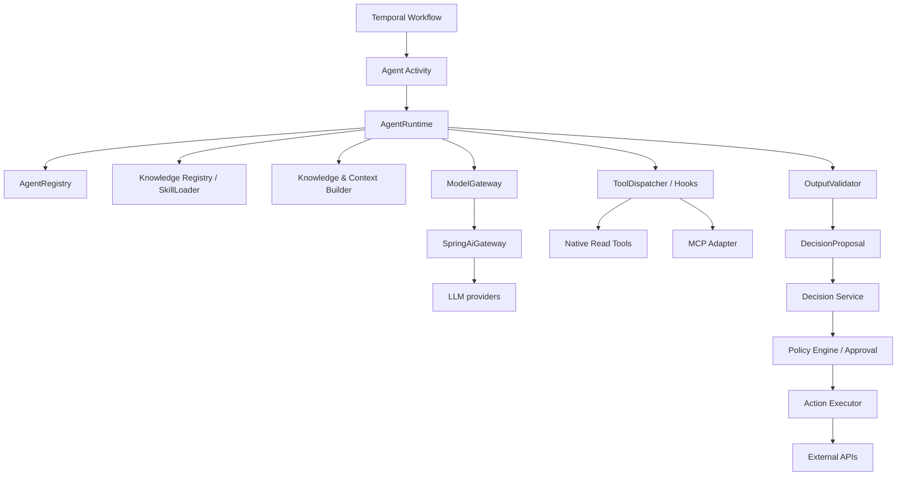

# Autonomous E-commerce Operator — detailed AI architecture

Version: 1.2 · Date: 14 November 2026 · Status: draft for review

Related: [product concept and MVP](01-PRODUCT-VISION-AND-ARCHITECTURE.md) · [Inventory Guardian end-to-end](03-INVENTORY-GUARDIAN-E2E.md) · [UI/UX and view APIs](04-UI-UX-SPECIFICATION.md).

The legend and the limited availability of the source material from the [product document](01-PRODUCT-VISION-AND-ARCHITECTURE.md#1-basis-and-how-to-read) apply: **[D]** decision, **[U]** agreed direction, **[P]** new refinement, **[Z]** assumption, **[O]** open question. The contracts and limits below are **[P]** unless marked otherwise. Java fragments and pseudocode show architectural boundaries; they are not a complete, compilable design.

## 1. Architectural principle [D, U]

**D-03:** We build our own bounded Agent Runtime with our own `ModelGateway`; Spring AI is the primary adapter to models. **D-02:** The LLM proposes a decision; the backend controls whether it is allowed and how it is executed. The agent may choose the next analytical tool within a task. The workflow defines the durable business process and its stages.

The operating model carries patterns learned from Anthropic Architect Foundations over to the application level: tool design, procedural Skills, context selection, lifecycle hooks and delegation. We do not assume access to the full course content or compatibility with a specific SDK. Anthropic's official description distinguishes workflows with a fixed structure from agents that choose their steps dynamically; we use this distinction in the design. [Source: Building effective agents](https://www.anthropic.com/research/building-effective-agents).

| Element | Role | Example |
|---|---|---|
| Agent | A decision profile run for a task | Inventory Agent |
| Skill | A versioned analysis procedure | `inventory-guardian@1.0.0` |
| Tool | A typed domain operation | `get_inventory_forecast` |
| Policy | An enforceable permission and risk rule | Pause only a dedicated, verified ad |
| Workflow | The durable lifecycle of handling a problem | Signal → analysis → approval → action → verification |
| Hook | A lifecycle point that triggers a control | `BeforeToolCall` |
| MCP | A protocol for delivering tools and context | Optional external CRM |
| Decision | A persisted proposal and its resolution | `DecisionProposal` + `PolicyEvaluation` |

A skill describes the procedure, a tool performs an operation, a policy enforces the boundaries. The instruction "do not change an ad without approval" in a skill is useful for answer quality, but the enforcement guarantee comes from the backend API.

## 2. Layers and dependency boundaries [U, P]



The Intelligence layer contains profiles, skills, context, the runtime and validation. Business & Execution contains Opportunity, decisions, policies, approvals, the Action Registry and Temporal. Integration & Data contains adapters, normalization, PostgreSQL and metrics. Provider SDK types and Spring AI classes do not leak into domain contracts.

Update D-08/D-09 introduces the four Decision Intelligence sources. It does not add a second runtime or separate microservices. The extended responsibilities are described in section 16, and the details and contracts in [05 — Decision Intelligence Architecture](05-DECISION-INTELLIGENCE-ARCHITECTURE.md).

**[P] Packages:** `intelligence.runtime`, `intelligence.skills`, `intelligence.tools`, `intelligence.models`, `intelligence.context`, `intelligence.decisions`; `automation.policies`, `automation.approvals`, `automation.actions`, `automation.workflows`; `integrations.*`, `commerce.*`, `audit`. We control dependencies with an architecture test. Mixing marketing logic with Meta HTTP objects is confined to the adapter.

## 3. Profiles and the Agent Runtime

### AgentDefinition

```java
public record AgentDefinition(
    String name,
    String version,
    String systemPromptRef,
    Set<String> availableSkills,
    Set<String> allowedReadTools,
    ModelPolicy modelPolicy,
    RunLimits limits,
    String outputSchemaVersion
) {}
```

Agreed profiles: Marketing Agent, Inventory Agent, Operations Agent and Business Analyst; decision D-07 adds the Customer Support Agent. They share the runtime; we activate only the competences needed in the deployed process. A profile is not a microservice or a separate memory store. The competences of the new profile are described in section 14.

Sample configuration **[Z]**:

```yaml
agent:
  name: inventory-agent
  version: "1.0.0"
  availableSkills: ["inventory-guardian@1.0.0"]
  allowedReadTools:
    - get_inventory_forecast
    - get_replenishment_plan
    - get_product_ad_mappings
    - get_ad_delivery_state
    - get_recent_actions
  modelPolicy: INVENTORY_BALANCED
  outputSchemaVersion: "1.0"
  limits:
    maxModelCalls: 5
    maxToolCalls: 8
    maxWallTimeSeconds: 60
    maxInputTokens: 12000
    maxOutputTokensTotal: 4000
    maxEstimatedCostUsd: "0.10"
    maxOutputRepairCalls: 1
```

The limits apply to the whole run, including JSON repair and fallback. We reserve the cost before the call and settle the reported usage after the response. A cost estimate requires a versioned price list; the example is not an offer for any model. Unknown usage is marked as incomplete. Exceeding any limit ends the analysis with a controlled `RunFailure` or an approved `WAIT_FOR_DATA` result; it never generates a pause automatically.

### Our own loop

1. The backend establishes a trusted `RunContext`: tenant, store, integrations, roles, Opportunity and snapshot identifiers. The model does not supply these values as authorization.
2. The runtime loads the profile version, the Skills metadata and the selected procedure. For Inventory Guardian the choice is deterministic from the workflow type.
3. The Context Builder assembles a minimal context with evidence; the registry computes the intersection of the permissions of the profile, skills, tenant and integration state.
4. `BeforeModelCall` checks the budget, the deadline and the context. The gateway performs one model step.
5. The runtime checks whether the result is complete, valid and within the limit. A truncated response is neither a complete tool call nor a decision.
6. For every tool call it validates the name, arguments, resource scope and permissions; it runs the hooks, the tool and the result validation. The `toolCallId` links are kept in the history.
7. Results go back as tool data to the next step. Independent reads may run in parallel in a limited pool; dependent ones run sequentially.
8. The final result goes through JSON Schema and domain validation. The backend assigns identifiers and stores the proposal. Every error ends in an explicit state.

The model may end the analysis earlier. A duplicate of the same read within one snapshot may use a cache of appropriate freshness. Repeating identical failing calls uses up the limit and ends the run. `ToolDispatcher` never calls an arbitrary method by a name supplied by the model.

## 4. ModelGateway and Spring AI

```java
public interface ModelGateway {
    ModelCapabilities capabilities(ModelId modelId);
    ModelTurn complete(ModelRequest request);
}
```

| Contract | Required information |
|---|---|
| `ModelRequest` | Trusted run ID, ordered messages, tool definitions, output schema, model policy, deadline, limits |
| `ModelTurn` | Complete tool calls or final content, finish reason, usage, provider request identifier |
| `ToolCall` | Opaque provider ID, name from the registry, JSON arguments, completeness information |
| `ModelCapabilities` | Tool calling, supported JSON Schema subset, structured output, input/output limits, streaming and model options |
| `ModelFailure` | Error type, retryability, retry-after, provider request ID; no tokens and no raw secrets |

**D-03:** `Domain Runtime → ModelGateway → SpringAiGateway → Provider`. If Spring AI lacks a feature, we allow a dedicated adapter behind the same port. **[O]** The first provider and specific models depend on evaluation; we do not freeze model names or current prices in the design.

Spring AI provides integrations and tool calling mechanisms, but its default automatic loop must not execute a tool outside the runtime's control. The adapter must return the tool call request to our loop. In the chosen version we disable automatic execution and test this condition. The current documentation describes a user-controlled mode; setting names differ between lines. [Source: Spring AI Tool Calling](https://docs.spring.io/spring-ai/reference/api/tools.html).

### Capability matrix and fallback

| Property | Requirement and behavior |
|---|---|
| Tool calling | Required for a profile with dynamic tool selection; without it the model is excluded from this path |
| Native structured output | Preferred; local validation always applies |
| Schema without native support | Restricted JSON mode + validation and at most one repair; allowed after evaluation |
| Tool calling together with a schema | If unsupported, a final step without tools generates the proposal from the same evidence |
| Different message roles and formats | The adapter maps them explicitly; the runtime stores a canonical format and call identifiers |
| No usage or context limit | A conservative local limit, an explicit estimate marker |
| Timeout / throttling / unavailability | Limited retry within the deadline, then fallback or failure |

Routing filters models by the required capabilities, data processing consents, quality on the evaluation set, availability and cost. Higher risk does not automatically mean a "bigger model" or broader permissions.

**[P] A fallback between providers starts a new analysis attempt on the same canonical snapshot.** We do not carry unclosed tool calls between different protocols. We record the model of every attempt and a shared cost limit. After an accepted proposal is stored, a fallback must not overwrite it. A change of the result creates a new revision and requires a new policy evaluation/approval.

Boundary test: a fake model returns `pause_ad`; the gateway does not execute it, and the dispatcher rejects it as a tool outside the read allowlist. Second test: the model returns a tool call, and the only execution counter increments only in our dispatcher. This prevents a hidden second loop.

## 5. Tool Registry and tool design

```java
public interface AgentTool<Input, Output> {
    ToolDefinition definition();
    Output execute(ToolExecutionContext context, Input input);
}
```

The registry stores the `name`, `version`, a description of use and limitations, `inputSchema`, `outputSchema`, permissions, `effectType`, timeout, size limit, cache rules, data classification and the implementation. Effects: `READ`, `PROPOSE`, `MUTATE`. **D-02:** In the MVP the model loop gets only `READ`; the proposal is the model's output, and `MUTATE` lives in the executor's Action Registry.

The backend sets the `ToolExecutionContext`. There is no `tenantId`, token or arbitrary URL in the arguments visible to the model. Even a valid ad identifier must be resolved within the tenant and integration scope. Tool errors have a code (`NOT_FOUND`, `FORBIDDEN`, `STALE_DATA`, `RATE_LIMITED`, `UNAVAILABLE`), a safe description and retry information.

| Tool | Input | Result and limitations |
|---|---|---|
| `get_inventory_forecast` | `productVariantId`, `asOf` | Sellable stock, sales velocity, days of cover, method, quality, evidence IDs |
| `get_replenishment_plan` | `productVariantId` | Deliveries, quantities, ETA, confirmation status; no integration gives `UNAVAILABLE` |
| `get_product_ad_mappings` | `productVariantId` | Mappings to ads, product scope, confirmation method and creative fingerprint |
| `get_ad_delivery_state` | `adId` | Account, campaign/adset, configured and effective status, read time |
| `get_recent_actions` | `resourceId`, limited period | Operator actions and detected external changes, active locks |
| `get_campaign_performance` | `campaignId`, period | Aggregates of costs and results with attribution metadata |
| `get_product_profitability` | `productVariantId`, period | Margin and allocations, or explicit gaps; no false precision |

The last two are marketing and finance competences; the Inventory Agent does not get them without need. Aggregates are computed by code, and the model interprets the results. We return bounded sets and summary metrics instead of thousands of order records. Period, ID and enumeration parameters have closed schemas; `additionalProperties: false` eliminates unknown fields at the boundaries.

A read result has a `snapshotId`, `observedAt`, `sourceUpdatedAt`, `completeness`, `quality`, `evidenceIds` and the data. If a tool obtains a newer observation, the Context Builder creates the next snapshot revision or explicitly attaches the new evidence. The proposal points to the exact version of the set used; we do not quietly combine states that are inconsistent in time.

## 6. Skills: procedures, versions and loading

**U-04:** A skill is the basic unit for extending competences. Our own loader works for all providers: metadata for selection, the full instruction after selection, references only when needed. The `SKILL.md` format and the optional directories are inspired by the open [Agent Skills specification](https://agentskills.io/specification). The additional runtime restrictions are our contract.

```text
skills/
  inventory-guardian/
    SKILL.md
    manifest.yaml
    references/
      inventory-semantics.md
      ad-mapping-rules.md
    examples/
      pause-single-product.json
      ambiguous-catalog.json
    evals/
      cases.jsonl
```

Sample frontmatter:

```yaml
---
name: inventory-guardian
description: Analyzes the stockout risk and chooses a reaction for the linked ads.
metadata:
  version: "1.0.0"
  owner: "commerce-operations"
---
```

We put the version in `metadata` instead of assuming that an arbitrary `version` field is part of the standard. Our own `manifest.yaml` binds the skill to the output schema, the required read tools, the data scope and the evaluation set. The procedure content for this example is in the [E2E scenario](03-INVENTORY-GUARDIAN-E2E.md#5-skill-and-prompt).

**[P] Lifecycle:** draft → business and technical review → evaluation on fixed cases → shadow → version activation → monitoring → rollback. The registry stores an immutable hash of the package. Every `AgentRun` records the pinned versions of the skill, prompt, tools, schema and model policy. An update does not change an ongoing analysis or an approved proposal.

The MVP loads only approved application packages. A skill does not increase the profile's permissions and does not define an enforceable policy. Instruction files cannot run arbitrary scripts; calculations and integrations go through registered backend code. Procedures from a customer or an external repository would need a separate admission process. They are not part of the first release.

## 7. MCP and integrations [U, P]

MCP is an optional way to deliver tools, resources and prompts. The protocol has host/client/server roles; in our system the host is the backend runtime, and the client connects to an approved server. [Source: MCP Architecture](https://modelcontextprotocol.io/specification/2025-06-18/architecture). The specific protocol revision will be pinned together with the client; the link describes the pattern and does not mandate this version for production.

```text
ToolRegistry → NativeDomainTool → WooCommerce / Meta adapter
ToolRegistry → McpToolAdapter   → approved MCP server
```

WooCommerce and Meta Ads have native adapters in the MVP. MCP does not replace the domain API, the policy engine, the source of truth or Temporal. A tool name from a server does not mean trust in its effects.

**[P] MCP boundary:** an allowlist of servers and tools, pinned/verified schemas, name and version mapping, time and response limits, limited credentials, authorization of every resource. Dynamic discovery does not publish tools directly to the model. A contract change blocks the tool until it is approved again. The session and cache are isolated by tenant and principal; we do not treat a session ID alone as authorization. Tokens never reach the model or another server.

An external prompt/resource is treated as lower-trust data. An MCP tool with a write effect stays outside the read loop even when it declares itself safe. Our own Action Executor still enforces the permission. The benefit of MCP is the ability to add integrations without changing the runtime contract, not an automatic expansion of autonomy.

## 8. Context engineering, memory and hooks

### Context [U, P]

| Layer | Where it is stored | What goes into the run |
|---|---|---|
| Business State | PostgreSQL | Data of the given variant, orders/aggregates, ads and deliveries |
| Operational History | Decisions, actions, audit | Recent relevant actions and conflicts |
| Procedural Knowledge | Registry of skills and versions | The selected procedure and the needed references |
| Current run history | Run memory / controlled record | Tool messages needed to finish the analysis |

We do not need a vector database for a simple stock lookup by ID. Retrieval or semantic memory may appear with a large body of procedures or correspondence, once a need is shown. The result of an old decision is not evidence of the current stock state.

The context has a version, `asOf`, sources, the tenant scope, completeness flags and evidence references. Context compression keeps hard constraints, quality data and evidence links. Product descriptions and creative texts are untrusted data. An instruction in a product name cannot change the tool allowlist, the policy or the recipient of a notification. Order PII is not passed to Inventory Guardian.

### Hooks [U, P]

| Hook | Control | Behavior on error |
|---|---|---|
| `BeforeAgentRun` | Tenant, profile, snapshot, integration state | Stop run |
| `BeforeModelCall` | Deadline, cost, context size, redaction | Stop call |
| `AfterModelCall` | Usage, finish reason, parse, provider request ID | Reject an incomplete result |
| `BeforeToolCall` | Schema, allowlist, scope and permissions | Deny tool |
| `AfterToolCall` | Result schema, size, evidence and audit | Tool error; the result is not passed on as valid |
| `BeforeActionExecution` | Current policy, kill switch, state and conflict | Deny / expire / conflict |
| `AfterActionExecution` | Durable result, verification request | Uncertain state and reconciliation |

Safety hooks are deterministic code, not instructions to the model. A failure of a critical control closes the execution path. A metrics export failure does not have to block a read, but being unable to durably record the intent of an action blocks the mutation. The main invariants are also enforced directly at the executor boundary, so that another entry into the backend does not bypass the hook.

## 9. Decisions, policies and actions

### Canonical contract [P]

`DecisionProposal` contains a trusted envelope and an analytical part. The model generates only the `recommendation`; the backend binds it to the current run.

| Field | Author | Meaning |
|---|---|---|
| `schemaVersion`, `proposalId`, `revision` | Backend | Version and identity of the immutable proposal |
| `opportunityId`, `agentRunId`, `contextSnapshotId` | Backend | Link to the event and the evidence |
| `createdAt`, `expiresAt` | Backend | Validity set by the process policy |
| `recommendation.disposition` | Model | `ACT`, `NO_ACTION`, `ESCALATE`, `WAIT_FOR_DATA` |
| `recommendation.action` | Model | A typed action or `null` |
| `recommendation.evidenceIds` | Model, backend verification | References to existing evidence of this run |
| `reasonCodes`, `summary`, `uncertainties` | Model, backend validation | Rationale for a human, without chain-of-thought |

We distinguish the actions `PAUSE_AD`, `REDUCE_ADSET_BUDGET`, `REDUCE_CAMPAIGN_BUDGET` and `NOTIFY_OPERATOR`, and `action: null`. Budget actions are extension contracts; the default Inventory Guardian MVP executes only `PAUSE_AD`. Budget parameters require a target amount set by the backend, a currency and a base version, not a repeated "subtract 10%".

The Customer Support extension adds `SEND_SUPPORT_REPLY` and a link to a SupportCase per section 14. It does not change the `1.0` schema, the action list or the logic of the reference Inventory Guardian. A new contract version is admitted separately for the Support profile.

**E2E variant:** `PAUSE_AD` has exactly `type`, `targetType: META_AD`, `targetId`, `parameters: {desiredStatus: PAUSED}`. The ID set, permissions, mapping, preconditions and impact are set by the backend. `NOTIFY_OPERATOR` uses the configured channel, without an arbitrary address in the proposal. `ACT` requires an action; the other dispositions have `action: null`. The escalation notification may be sent by the workflow itself under a prior configuration.

**Validation:** JSON Schema, closed enumerations and fields, consistency of the disposition with the action, existence of the evidence, resource ownership, target type consistency, context completeness, an allowed operation type. The LLM does not set `approved=true`, does not create a PolicyEvaluation and does not sign an authorization. `confidence=0.95` alone, if we ever add it as a metric, is not enough to grant autonomy.

The table above keeps the `1.0` contract, and Support uses the `1.1` extension from section 14. The proposed `1.2` contract explicitly distinguishes `RECOMMEND_ACTION`, `MONITOR`, `NO_ACTION`, `INSUFFICIENT_DATA` and `ESCALATE`; the compatibility rules, the legacy mapping and the monitoring plan come from [05 — pipeline and contracts](05-DECISION-INTELLIGENCE-ARCHITECTURE.md#e-decision-making-pipeline-and-contracts). We do not add new values to the immutable `1.0` schema. MONITOR must not be quietly mapped to NO_ACTION; the rollout requires support in the consumers and the workflow.

### Policy Engine

Results: `ALLOW`, `REQUIRE_APPROVAL`, `DENY`, `DEFER`. `DEFER` means the conditions for a resolution are missing, e.g. waiting for a fresh read. PolicyEvaluation records the policy version, the input facts, reason codes, the evaluation time and the admitted scope.

Order: isolation and capabilities → kill switch and integration → validity and freshness → target/mapping consistency → conflict and history → autonomy/limits → approval. Safety violations cannot be "clicked through" with an approval. An approval applies to the revision hash, the target and the parameters, and has an author and a deadline. Resuming after an approval requires a new evaluation of the current policy and state.

For a pause, a percentage budget limit makes no sense: a pause has its own limit on the number of resources, the mapping scope and the operational impact. Budget reduction limits are computed cumulatively within a window against a defined base. We do not allow the limit to be bypassed through many small actions or different workflows.

### AuthorizedAction and execution

A trusted service issues a short-lived authorization bound to `proposalId/revision`, the tenant, the integration, the action, the target, the parameter hash, the policy version, the state requirements, the approval and an idempotency key. In the monolith an unforgeable reference to a durable record and a controlled constructor are enough; if services are split, an appropriately secured contract is needed. JSON with such fields from the model is not an authorization.

Under a resource lock, the executor checks the authorization, the current conditions and the action register, records the intent, calls the adapter and records the result. An authorization does not become invalid for a safe reconciliation of the same action only because its first use happened before a failure; a new mutation after expiry requires a new authorization. We never call the API first and only later try to reconstruct why it was allowed.

### States and transitions

| Object | Path / branches |
|---|---|
| Opportunity | `DETECTED → ANALYZED → PROPOSED`; `WAITING_DATA → ANALYZED` after a refresh |
| Evaluation | `PROPOSED → APPROVED` on ALLOW; `WAITING_APPROVAL → APPROVED` after approval and a recheck |
| No execution | `NO_ACTION`, `REJECTED`, `EXPIRED`, `CANCELLED` with a reason and the possibility of a new analysis |
| Execution | `APPROVED → EXECUTING → VERIFIED → CLOSED`; on a problem `CONFLICT`, `FAILED`, `UNKNOWN` |
| ActionExecution | `PLANNED → IN_PROGRESS → APPLIED → VERIFIED`; alternatively `NOOP`, `UNKNOWN`, `FAILED`, `CONFLICT` |

`APPLIED` means the request was accepted or the effect was observed; `VERIFIED` means the required conditions were confirmed. `NOOP` may close the problem if the requested state already existed, but we do not attribute the change to the operator. `UNKNOWN` requires reconciliation. A closed Opportunity keeps its result; the next episode gets a new identifier. The full table of allowed transitions will be an implementation contract, with a test that rejects illegal transitions.

## 10. Temporal and failure semantics [U, P]

The workflow is responsible for the order of Activities, timers, waiting for approval, resumption and completion. HTTP to models and integrations, database writes and reads of the current policy are performed by Activities. The workflow operates on recorded results; it does not read the system clock, randomness or Spring configuration on its own on every replay.

`AgentActivity` is a short-lived, limited task. A retry may call the model again if the result was not durably stored. Therefore the analysis request has a stable key and a separate result record; a re-execution first checks for an existing result. A double model cost remains possible on a failure in the narrow window after the response and before the write. This does not mean a double business action.

Retry policies are separate for reads, analysis, execution and verification. A status change with an ambiguous result triggers a read, not a blind POST. Temporal recommends idempotent Activities, because the code may run again. [Source: Activity Definition](https://docs.temporal.io/activity-definition).

**[P] Approval:** the trusted API checks the user, the tenant and the revision, stores the approval and sends a signal to the workflow. Signal repeats are deduplicated by the approval ID. The workflow has a deadline; a late approval for an old revision does not start the action. A new stock signal while waiting may invalidate the proposal. The signaling method and tests are shown in [Inventory Guardian](03-INVENTORY-GUARDIAN-E2E.md).

**[P] Conflicts:** serialization by `tenant + integration + targetType + targetId` and a check of parent resources for adset/campaign actions. The lock does not cover an external Meta user. When the API does not offer a conditional write, a gap remains between the read and the mutation; we narrow it with a short time, a small scope and a recheck, and escalate a conflict after the write. We do not claim atomicity with Meta.

## 11. Delegation and further development [U, P]

MVP: one runtime, several profile definitions, no mandatory multi-agent framework. When evaluation shows value, a central orchestrator may call the Business Analyst as a subagent. It gets only the subtask and the needed snapshot, returns a typed result with evidence, and is subject to the shared budget and deadline.

Delegation has a maximum depth and an allowlist of allowed relations; it cannot create unbounded recursion. A subagent does not get the right to mutate or to further expand permissions. A subagent's result is material for validation, not source evidence. Divergent assessments trigger an escalation or an additional read, not a vote that grants permissions.

## 12. Observability, evaluation and acceptance criteria [P]

One correlation path: `tenantId → opportunityId → workflowId → agentRunId → proposalId/revision → actionId`. We record the snapshot and its hash, the versions of the profile/skill/tools/prompts/policy, the model and parameters, tool calls, a concise rationale, evidence, usage, the approval and the verification result. We do not require the model's private chain-of-thought. Replaying a historical input may give a different model text; reproducibility of conditions and evidence does not mean an identical answer.

Prompts and responses are subject to retention and redaction. Secrets are not logged. Large snapshots can be stored outside the Temporal history, and a reference and a hash passed to the workflow. Reading such a reference also requires the tenant scope.

| Test level | What we check |
|---|---|
| Unit | Forecast, freshness, mappings, policies, validators and state transitions |
| Contract | Gateway, capabilities, tools, the proposal schema, API adapters |
| Isolation and abuse | A foreign tenant ID, fake evidence, prompt injection, an unknown tool, a forged authorization |
| AI evaluation | Fixed business cases for every skill/model pair; correctness of decisions and evidence |
| Workflow | Replay, timers, signals, timeout, crash/retry and an ambiguous effect |
| Shadow / pilot | Acceptance rate, false pauses, cost, reaction time and audit completeness |

**[Z] Gate to L2:** zero executed unauthorized actions in tests; all uncertain mapping cases from the regression set escalate; every mutation has a full audit; cost and quality are within the agreed pilot targets. Diagnostic quality thresholds are set on store data and with an explicit denominator. Zero errors on a finite set does not guarantee future behavior.

## 13. Resolutions before implementation [O]

1. Choose stable, compatible versions of Java/Spring Boot/Spring AI/Temporal SDK and confirm there is no automatic second tool loop.
2. Choose models based on test data, capabilities, budget and the allowed processing regions.
3. Approve the `DecisionProposal v1` schema, the skills manifest and the version evolution rules.
4. Settle the retention of snapshots, the audit and prompt content, the roles that can read them and where they are stored.
5. Confirm the stock semantics, the mapping and the pause conditions from the E2E document before activating L2.

Product scope and the shared decision register: [01 — Product](01-PRODUCT-VISION-AND-ARCHITECTURE.md). Reference implementation of the contracts: [03 — Inventory Guardian](03-INVENTORY-GUARDIAN-E2E.md).

## 14. Customer Support Agent [D, P]

**D-07:** E-mail support is part of the MVP. The contracts below are an implementation proposal within the existing runtime, Policy Engine, Action Executor and Temporal. Operator interactions and endpoints are described in one place: [Customer Support UI](04-UI-UX-SPECIFICATION.md#6-customer-support--conversation-detail).

### Domain model and responsibilities [P]

| Object | Scope and relations |
|---|---|
| `Conversation` | A thread of the store mailbox, participants, message order, version and ownership mode |
| `Message` | An incoming/outgoing message, AI/human/system origin, provider ID and send status |
| `SupportCase` | The goal of handling within a conversation, classification, priority, current context and result |
| `CustomerContext` | Verified customer–order links and the scope of data that may be disclosed |
| `Escalation` | Reason, urgency, summary, missing data, a draft and the handling owner |
| `ResponseDraft` | Versioned reply content, linked facts, the trigger message and the content hash |
| `HumanAssignment` | Operator, takeover time, ownership version and an explicit hand-back to the agent |
| `SupportPolicy` | Allowed L2 categories, information sources, limits, identity and escalation rules |

A Conversation has the working state `NEW`, `AI_HANDLING`, `NEEDS_HUMAN`, `HUMAN_OWNED`, `RESOLVED`, independent of the Message send status. A new message may reopen a resolved case. We do not create an Opportunity for every e-mail; the SupportCase is the root of the process. If a conversation requires a separate business decision, we create and link an Opportunity, keeping the messages in Support.

**Contract extension:** `DecisionProposal schemaVersion=1.1` for the Support profile adds the trusted `supportCaseId`, `conversationId`, `triggerMessageId`, `conversationVersion`, `ownershipVersion`; `opportunityId` may be `null`. The rest of the envelope and the dispositions from section 9 keep their meaning. `ACT` with `SEND_SUPPORT_REPLY` points to `targetType=SUPPORT_CONVERSATION` and a target consistent with the context. In the parameters the model proposes `bodyText` and references to facts; the backend creates an immutable ResponseDraft revision and binds its ID/hash to the proposal before evaluation and sending. The model does not supply arbitrary recipients, a sender address, CC/BCC or headers.

`ESCALATE` has `action: null`, a summary and reason codes; the workflow stores the Escalation and the ResponseDraft as an internal result. A draft attached to an escalation is not automatically admitted for sending. An edit by a human creates a new draft version and a policy evaluation before sending; a manual send still uses the shared executor/ledger, with the operator's principal and without requiring an LLM run.

### Skills and read tools [P]

| Skill | Result |
|---|---|
| `classify-customer-request` | Category, urgency, language and required sources |
| `answer-order-status` | A reply based on a verified order link |
| `answer-product-question` | A reply from the catalog and the store's approved knowledge |
| `draft-customer-response` | A draft with fact references, without sending on its own |
| `prepare-support-handoff` | Problem summary, checks performed, escalation reason and a proposed reply |

| READ tool | Model input | Enforced boundary |
|---|---|---|
| `get_conversation_history` | `conversationId`, a limited number of messages | Only the current case and the necessary history |
| `get_order_status` | `orderId` from the admitted context | A verified customer–order link and freshness |
| `get_order_details` | `orderId`, field scope | Minimal fields; no payment data and no excess PII |
| `get_product_details` | `productVariantId` | Catalog facts with a version and a read time |
| `get_store_policy` | Policy type, language | Only the published version of the store's rules |

The local `get_product_details` may use the existing Commerce Service; we do not duplicate the Woo integration. Attachments and message content are untrusted data. The runtime does not execute links, instructions or code from an e-mail. Without a shipment status source, a delivery date cannot be given; the order status does not replace carrier tracking.

### Reply policies and human handoff [P]

| Category | MVP behavior |
|---|---|
| Order status | L2 after verifying the relation, current data and allowed fields; otherwise escalation |
| Product facts and store rules | L2 on approved sources, without inventing promises and entitlements |
| Complaint, unusual case, conflicting data | NEEDS_HUMAN, a summary and a draft |
| Address change, cancellation, refund | Case preparation and escalation; no such mutations in the Support MVP |
| Uncertain identity or a request for someone else's order | No data disclosure; escalation or an approved neutral message |
| Case taken over by a human | No automatic reply; the AI may prepare a draft on request |

SupportPolicy checks the conversation ownership, the trigger version, the integration state, recipient verification, fact sources, content restrictions, language, the reply limit and the kill switch. A high model confidence alone does not grant L2. A detector of automatic e-mails, bounces and autoresponders, and a per-conversation reply limit prevent loops. The recipient is set by the backend from the admitted mailbox–thread–customer relation; it does not trust an arbitrary Reply-To or an order number in the content.

The operator may take over a case, edit the draft, reply, resolve it or explicitly hand it back to the AI. A takeover atomically increments `ownershipVersion`, blocks new automatic sends and invalidates pending proposals. The executor checks the version again right before dispatch. A message already accepted by the provider cannot be recalled; the UI shows a send in progress and confirms the takeover with information about this boundary. A new e-mail from the customer invalidates a stale automatic reply draft.

### Workflow and e-mail reliability [P]

`IncomingMessage → Classification → Context → Skill → DecisionProposal → PolicyEvaluation → SendReply or HumanHandoff → Verification → Audit`.

The receiving adapter deduplicates the provider message ID within the mailbox; the Message-ID is auxiliary and gives no global authorization. The thread is built from the provider thread ID and verified headers, without mixing tenants. The incoming event and the outbox are durable. One active workflow per SupportCase serializes the handling of subsequent messages; a new trigger supersedes a pending reply before dispatch. Calls to the LLM, the database and mail are Activities.

Sending has the key `tenant/mailbox/conversation/triggerMessage/draftRevision`, a durable ledger and AI/human serialization. State: `DRAFT → QUEUED → SENDING → ACCEPTED`; further confirmations give `DELIVERED`, `BOUNCED` or `FAILED` if the provider exposes that data. A timeout after dispatch gives `UNKNOWN`; a safe read of Sent/the provider ID precedes a retry. If the provider does not allow a resolution, we block automatic resends and escalate. A stable Message-ID alone does not guarantee exactly-once at the recipient.

`ACCEPTED` confirms acceptance by the provider, not that the customer read it or that it reached the inbox. `DELIVERED` is shown only with available provider evidence and a description of its meaning. A bounce updates the result and opens an intervention; it does not start a dialog with an autoresponder. We do not promise exactly one external effect without an appropriate provider contract. The Temporal rules from section 10 remain shared.

### Audit, data and tests [P, O]

The audit links the SupportCase, conversation/message, run, draft revision, proposal, policy evaluation, principal, takeover, provider message ID and result. Content and customer data records have retention and access separate from the concise operational history. **O-11–O-13:** the mailbox provider, the identity verification method, roles, escalation times and the scope/retention of attachments need a resolution; until then there is no assumption of automatic analysis of all attachments.

Before L2 we test: a foreign order ID and sender spoofing, prompt injection, fictitious delivery dates, a missing source, a duplicated inbound message, a new message while a draft is being generated, a takeover right before dispatch, a parallel send by a human and the AI, a lost send confirmation, a bounce/autoresponder, token expiry and a policy change. A correct text reply does not replace the isolation and sending tests.

## 15. Decision representations for the UI [D, P]

D-06 requires three layers of information from one set of evidence: `Business Summary`, `Decision Explanation`, `Analytical Evidence`. The Summary uses the `summary` and the backend statuses; the Explanation combines reason codes, uncertainties, the action scope and the policy result; the Evidence takes the numbers from the snapshot and the analytics services. We do not generate three independent versions of the facts with the LLM. We present a practical rationale, without chain-of-thought.

The read layer returns the proposal version, the snapshot ID, evidence refs, metric definitions and contextual analysis links. Historical data used in the decision is distinguished from current analytics. Navigation keeps the dates, the store, the product and the campaign; the detailed presentation contract is in [UI/UX](04-UI-UX-SPECIFICATION.md#3-shared-frontendbackend-contracts-p).

## Changes in version 1.1

Added the Customer Support Agent, five Skills and five read tools, a decision contract extension, and reply and human takeover policies. Described the durable e-mail workflow, ambiguous sending and the audit. Added data representations for progressive disclosure; the existing runtime and Inventory Guardian keep their logic unchanged.

## 16. Decision Intelligence in the existing runtime [D, P]

The Knowledge Registry includes the existing SkillRegistry and also versions Playbooks and expert references. The SkillLoader still loads the selected procedure; a Playbook links procedures and analysis scenarios, and Tools provide the data. Deterministic rules/metrics are application code; Skills do not override them. Policies and workflows keep the existing execution boundaries.

The Knowledge & Context Builder is an extension of the current Context Builder: it combines the right versions of Domain Knowledge, the Store Business Profile, Operational Data and Decision Experience. The Store Profile sets the goal and preferences, the Metrics & Evidence Engine provides computed KPIs, quality and lineage, Decision History exposes the history, and the Outcome Evaluator feeds it with observations together with the limits of their interpretation. History is not causal evidence and does not change the strategy on its own. The Offline Evaluation Framework checks new versions of Skills, definitions and models before activation.

Context and evidence are independent of the LLM; the existing ModelGateway adapts them to the capabilities of a specific model. A run also pins the store profile, the knowledge release, the metric definitions and the context manifest. Financial calculations are performed by the backend, and every recommendation has verified evidence refs. New reads of knowledge/profile/history are subject to the existing tenant scope and the ToolDispatcher; they do not publish the whole database to the model. Full responsibilities, Java/JSON contracts and the validation path: [05](05-DECISION-INTELLIGENCE-ARCHITECTURE.md).

## Changes in version 1.2

Extended the existing Registry and Context Builder with Decision Intelligence and described the relations with metrics, the profile, history and evaluation. Added a reference to the proposed evolution of the decision contract, without rewriting the runtime, the gateway, Temporal and the Policy Engine.
