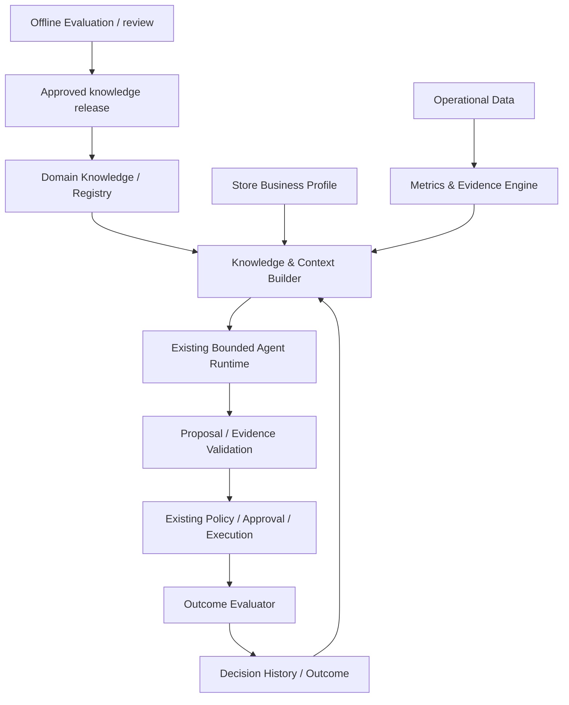

# Autonomous E-commerce Operator — Decision Intelligence Architecture

Version: 1.0 · Date: 14 November 2026 · Status: detailed specification for review

Related: [01 — product and MVP scope](01-PRODUCT-VISION-AND-ARCHITECTURE.md), [02 — Agent Runtime and execution](02-AI-AGENT-ARCHITECTURE.md), [03 — Inventory Guardian E2E](03-INVENTORY-GUARDIAN-E2E.md), [04 — UI/UX](04-UI-UX-SPECIFICATION.md).

The common legend applies: **[D] decision / [U] agreed direction / [P] proposal / [Z] assumption / [O] open question**. D-08/D-09 approve the four knowledge sources and the scope of Decision Intelligence in the MVP. The details of the structures, the `1.2` contract, the package names and the procedures in this document are **[P]**, and the numbers in the examples are **[Z]**. We do not describe an existing implementation or a verified effectiveness of a marketing strategy.

Scope of the document: where business knowledge comes from, how to build the basis of decisions and how to evaluate results. The ownership of the agent loop, Spring AI, MCP, hooks, authorization, idempotency and Temporal keep the specification from document 02; they are not defined again.

## A. Knowledge architecture

### A1. Four sources [D]

| Source | What it contributes | Operational truth and storage | Main limitation |
|---|---|---|---|
| Domain Knowledge | How to analyze a situation: Skills, Playbooks, expert references | Versioned files and Knowledge Registry metadata | An instruction does not grant permissions or prove that a rule is right in every store |
| Store Knowledge | What matters: goals, economics, preferences, approved strategy | Store Business Profile in PostgreSQL and references to costs/policies | A GROWTH goal does not override spend and risk limits |
| Operational Data | What is known about the store and ads at a given time | Normalized observations, the Metrics & Evidence Engine, snapshots | Reported, estimated, incomplete and delayed data have different limitations |
| Decision Experience | What was proposed, executed and observed | Decision History, ActionExecution, Outcome and expert assessments | Correlation in history is not causal evidence of effectiveness |

The model's base knowledge is an ability to interpret and to use language, not a fifth authoritative source of facts about the store. When a required fact is not in the four sources, the agent points out the gap. It does not fill an unknown COGS with a "typical industry margin".



The Outcome → History arrow does not update the Registry, the policy or the strategy on its own. A release requires a controlled review. All components run in the Spring Boot modular monolith; timers and durable processes are handled by the existing Temporal.

### A2. Registry, Skill, Playbook and rule [P]

The Knowledge Registry extends the SkillRegistry instead of creating a parallel catalog. It provides ID/version resolution, a hash, release status, scope, compatibility and provenance. Sample layout:

```text
intelligence/knowledge/
  marketing-pack/
    release.yaml
    skills/
      campaign-diagnosis/SKILL.md
      budget-optimization/SKILL.md
      creative-fatigue-analysis/SKILL.md
      profitability-analysis/SKILL.md
      campaign-learning-analysis/SKILL.md
      scaling-readiness/SKILL.md
    playbooks/
      performance-deterioration.md
      profitable-growth.md
      insufficient-conversions.md
    references/
      source-manifest.yaml
      attribution-and-reporting.md
    evals/
      cases.jsonl
      expert-rubric.yaml
```

| Artifact | Responsibility | Boundary example |
|---|---|---|
| Skill | The procedure of one competence, required data, abstention criteria and the result | Diagnoses creative fatigue; does not publish a new ad |
| Playbook | Links scenarios, the order of competences and response variants | Performance drop → data quality → diagnosis → possibly a recommendation |
| Deterministic rule | A calculation or validation in code with a version | CPA, period completeness, budget, evidence consistency |
| Policy | An enforceable admissibility boundary | No spend increase in the MVP, required approval and scope |
| Temporal Workflow | Durable execution of stages and waiting | Schedule a re-analysis, keep the deadline |

A Playbook is not an arbitrary executable workflow or a hidden script. Its rules for choosing stages map to approved application capabilities. Even if a Skill recommends a budget improvement, execution depends on the existing action catalog and policies; the Marketing Pack alone does not extend the MVP with autonomous budget increases.

### A3. Provenance, reliability and updates [P]

Every knowledge entry has: `knowledgeId`, type, version, content hash, author/owner, the source and a URL or material identifier, `publishedAt`, `retrievedAt`, `reviewedAt`, `reviewDueAt`, the platform/API scope, assumptions, applicability, review status and the approving release. An expert's own material has an author, a date and the scope of observation; the lack of a public URL does not leave it without provenance.

Source levels **[P]**: `OFFICIAL_PLATFORM`, `EXPERT_REVIEWED`, `STORE_APPROVED`, `OBSERVATIONAL`, `UNVERIFIED`. These are provenance classes, not a ranking that automatically resolves every case. For API properties the basis is the matching version of the platform documentation; for a business goal, the approved store profile; for current stock, the operational source. An official marketing guide does not prove the store's profitability. Unverified material does not drive an action on its own.

An approved release binds the versions of Skills, Playbooks, references, metric definitions and minimal capabilities. A material change requires a new version and tests. A new version of external documentation does not automatically replace the procedure in use. An overdue review or withdrawn material triggers an applicability check; a critical incompatibility blocks new analyses until review, without deleting history.

Lifecycle: an author/expert prepares a change → technical and business review → offline tests → shadow → approval → activation for a selected scope → monitoring → possibly a rollback. An ongoing run pins the release. A critical safety withdrawal may stop a future mutation despite the knowledge pinned earlier. The model has no write tool for the Registry and does not grant the `APPROVED` status to its own output.

Global knowledge is shared without customer data; profiles and store experience have a tenant/store scope. Tenant overrides are explicit versions with a review, not appended text with a higher priority than the system/policy. The cache and retrieval filter by scope before choosing results. Cases from other stores require prior admission and anonymization; the MVP does not assume sharing their history.

## B. Store Business Profile

### B1. Model and goals [D, P]

StoreBusinessProfile stores the store's intent and references to its economics; it does not replace the policy engine, the cost catalog or the integrations. A version is immutable after approval. Data model:

| Group | Fields / semantics |
|---|---|
| Identity | Profile ID, tenant, store, version, status DRAFT/APPROVED/SUPERSEDED, effectiveFrom, approvedBy |
| Goals | `PROFITABILITY`, `GROWTH`, `BALANCED`; priorities and horizon, a description of the preferred trade-off |
| Economics | Currency and tax basis, refs to versioned per-SKU COGS, fulfillment, fees, returns and other costs |
| Budget | A declared spend plan with a period, the account/channel scope, refs to hard policies; observed Meta budgets separately |
| Risk | LOW/MEDIUM/HIGH as a preference, an acceptable loss with a currency/horizon, a minimum margin as a goal; values may be unknown |
| Strategy | E.g. cash preservation, stock continuity, customer acquisition, seasonal priorities; dates and applicability |
| Quality | Missing fields, conflicts, provenance of every significant field, source confidence and operator confirmations |

PROFITABILITY prioritizes the known contribution to margin and the risk of loss; GROWTH allows considering growth within the allowed limits; BALANCED requires an agreed compromise. This is a direction for ranking recommendations, not a predefined budget multiplier. No goal authorizes increasing spend. **O-19:** how a store defines the expected horizon and trade-off before we enable recommendations that depend on this data.

Example **[Z]**, approved data and explicit gaps:

```json
{
  "profileId": "store-profile-01",
  "tenantId": "tenant-dtc-01",
  "storeId": "store-01",
  "version": 3,
  "status": "APPROVED",
  "effectiveFrom": "2026-11-14T07:00:00Z",
  "goal": "BALANCED",
  "planningHorizonDays": 30,
  "riskPreference": "LOW",
  "currency": "PLN",
  "taxBasis": "EX_TAX",
  "economicModelRef": "economics-01@5",
  "plannedAdSpend": {
    "amountMinor": 3000000,
    "currency": "PLN",
    "period": "2026-11",
    "scope": "META_ACCOUNT:act-700"
  },
  "policyRefs": ["inventory-protection@1.0.0", "marketing-controls@2"],
  "priorities": ["INVENTORY_CONTINUITY", "CONTRIBUTION_MARGIN"],
  "missingFields": ["MAX_ACCEPTABLE_ACQUISITION_LOSS"],
  "fieldProvenance": {
    "goal": {"sourceType": "STORE_APPROVED", "approvedBy": "user-owner-01"},
    "economicModelRef": {"sourceType": "STORE_APPROVED", "sourceRef": "financial-inputs@5"}
  }
}
```

PLN 30,000 is an example of a plan, not a general product limit. The missing loss tolerance blocks only the analyses that need such an assumption. The goal field may be unset in a draft; we do not give the model an unapproved default as the owner's decision.

### B2. Automatic acquisition, conflicts and gaps [P]

Integrations provide observations: revenue, prices, discounts, orders, ad budgets, stock and available costs. Not all Woo stores have COGS available; the integration does not prove that it exists. From the data we can prepare a suggestion of costs and a goal, but the goal/loss thresholds are approved by a permitted user. A budget in Meta is not equivalent to the store's total monthly plan.

A field may have an approved value, observed candidates and a conflict. Precedence is defined per domain: e.g. the agreed WMS for stock, the approved cost catalog for COGS, current Meta for ad configuration. A manual override has an author, a justification, an effective date and a review/expiry. We do not quietly choose the newest or the most favorable margin.

A change of the source COGS creates a revision of the economic model and a recalculation proposal; we keep the history of validity periods. A material conflict blocks the automatic decision that depends on that field, not all processes of the store. A profile that points to a policy contradicting the current Policy Engine does not override it. Every run gets a specific profile version; a material change between the analysis and the mutation requires revalidation/re-analysis.

## C. Metrics & Evidence Engine

### C1. Contracts and definitions [D, P]

The Engine is a deterministic extension of the current Commerce/Reporting aggregations and the Evidence register. It versions definitions, computes KPIs, validates periods and denominators, assigns quality flags and keeps lineage. The LLM may ask for a metric or explain a result; it does not provide an authoritative number computed in its own text.

| Metric | Definition / required restriction |
|---|---|
| Net Sales | Qualifying sales without tax, after discounts and revenue refunds; explicit inclusion/exclusion of shipping fees |
| Orders / AOV | The number of qualifying orders; `AOV = NetSales / Orders` on the same period and scope basis |
| Refunds / return rate | The refund amount and the share of returns in a defined cohort; a refund does not prove the stock came back |
| COGS | The unit cost valid for the sold unit; returns/recovery by an explicit method, not today's cost for all historical orders |
| Contribution profit | NetSales minus COGS, fulfillment, fees, ads and other variable costs; formula C2 |
| Spend | The cost reported by the advertiser in the currency and the account scope; billing maturity is a separate flag |
| Impressions / clicks | Counters with an explicit click type; link clicks are not interchangeable with all clicks |
| CPM / CPC / CTR | `1000*Spend/Impressions`; `Spend/Clicks`; `100*Clicks/Impressions`, with the same click type |
| CPA | `Spend/AttributedActions` for the chosen action type, goal and window; purchase CPA is not the CAC of a new customer |
| ROAS | `AttributedPurchaseValue/Spend`; a platform value, not the store's profit |
| Reach / frequency | Reach according to the platform for the right scope; frequency `Impressions/Reach`, accounting for the source's estimation |
| Conversion rate | A defined conversion / a defined base of sessions or clicks; without session data, no shop CVR |
| Inventory coverage | Sellable stock / sales velocity with versioned semantics and a window; the example's rules stay in document 03 |
| Learning / change history | A diagnostic state, the time and scope of changes, not a KPI computed from ROAS/CPA alone |

We do not average ROAS/CPA/CTR averages without correct weights; the aggregate is computed from the right components. Reach does not add up across days or ads as a number of unique recipients. With a zero/unavailable denominator the result is `null` with a reason; not infinity or zero. Metrics in different currencies stay separate until an explicit conversion with an exchange rate version.

Technical source: Meta Insights reports at the account, campaign, adset and ad level, with parameters such as the period and attribution. The adapter stores the scope and parameters used together with the result. [Official Meta Insights documentation](https://developers.facebook.com/documentation/ads-commerce/marketing-api/insights).

### C2. Margin and break-even ROAS [P]

We use a consistent basis without tax. In a given cohort/period `R = NetSales`, `V = COGS + Fulfillment + PaymentFees + OtherVariableCosts`, `A = AdSpend`. Return costs are accounted for in the appropriate components; revenue after returns is not reduced a second time by the same refund.

```text
ContributionBeforeAds = R - V
PreAdContributionMarginRate = (R - V) / R
ContributionProfit = R - V - A
ContributionMarginAfterAds = ContributionProfit / R
BreakEvenROAS = 1 / PreAdContributionMarginRate
```

The last formula follows from the condition `m*R - A = 0`, i.e. `R/A = 1/m`. It makes sense for `R>0` and `m>0`, with a comparable sales/cost mix and revenue attributed to the same spend. With `m<=0` there is no finite positive break-even ROAS under this model. It is not the company's accounting profit threshold: it does not automatically include fixed costs, capital or future LTV.

**Example [Z]:** R=PLN 10,000, V=PLN 6,000, m=0.40, A=PLN 3,000. ContributionBeforeAds=PLN 4,000, ContributionProfit=PLN 1,000, break-even ROAS=2.5. The ratio R/A=3.3333 concerns the same cohort. If 10,000 is the store's whole sales, the ratio is blended revenue/ad spend, not the Meta campaign ROAS. We do not compare it directly with the attributed gross value from Ads Manager.

A multi-product campaign needs a consistent margin mix and a method of attributing revenue/cost. A simple average of SKU margins gives a wrong threshold; we use the weight of the relevant sales or an explicit estimation model. Uncertain costs, expected returns or allocated ad spend give the result ESTIMATED. With missing critical components we do not compute a full break-even ROAS; a partial result with a clear scope may be shown, but it is not called confirmed profitability.

### C3. Quality, time and attribution [D, P]

`CONFIRMED`, `ESTIMATED`, `UNAVAILABLE` describe the quality of a value, independently of completeness, freshness and maturity. A deterministically computed result may be ESTIMATED if its components or allocation are estimated. "Fetched from the API" does not automatically mean CONFIRMED; e.g. conversions/reach modeled at the source keep the source's limitation. For every metric type the adapter documents the classification and its premises.

The Engine records the `period`, timezone, cohort/recognition basis, source refs, action type, attribution settings, the denominator definition, the completeness watermark and `maturity: PRELIMINARY|MATURE|UNKNOWN`. MATURE means that the approved data stabilization rule is met, not a guarantee of no future corrections. The rule is built from observed delays, the attribution scope and the store's tolerance; we do not set a universal "24 hours to the full truth".

Separately: `eventTime`, `sourceUpdatedAt`, `observedAt`, `ingestedAt`, `availableAt`, `computedAt`. The availableAt field indicates when a specific record/revision became available to the system. It enables a replay without knowledge from the future. A correction of historical conversions creates a revision; it does not replace the snapshot of an earlier decision.

When comparing ROAS/CPA we check: a shared action type and attribution settings, comparable windows (including the day of the week), conversion and synchronization delays, the number of events, seasonality, deliveries/promotions, the learning phase and the change history. We do not add Meta platform conversions and other channels together as unique orders. Platform attribution does not replace an incrementality experiment.

We fetch the learning state from the source if it is available; we do not infer it with certainty from a CPA increase alone. The Ad Set API describes `learning_stage_info` and the possibility of unstable results during learning. The availability of fields and their behavior are checked for the chosen version and account. [Official Meta Ad Set reference](https://developers.facebook.com/documentation/ads-commerce/marketing-api/reference/ad-campaign). No access to learning information gives UNKNOWN and increases caution, instead of creating a false "stabilized" state.

### C4. Evidence [P]

Evidence has an ID, tenant/store, a resource scope, a type (`OBSERVATION`, `DERIVED_METRIC`, `APPROVED_PROFILE`, `KNOWLEDGE_REFERENCE`), a version and a hash, a value/unit, times, quality, applicability, the calculation definition and dependent evidence IDs. Expert knowledge justifies a procedure but does not replace operational evidence of a sales drop. The profile proves the goal declared by the store, not a fact about ad results.

Example of a metric and its traceability **[Z]**:

```json
{
  "evidenceId": "ev-cpa-202",
  "version": "1",
  "tenantId": "tenant-dtc-01",
  "storeId": "store-01",
  "type": "DERIVED_METRIC",
  "metricKey": "META_PURCHASE_CPA",
  "definitionVersion": "2.0.0",
  "resourceRef": "META_CAMPAIGN:campaign-90",
  "valueDecimal": "48.00",
  "currency": "PLN",
  "unit": "PLN_PER_ATTRIBUTED_PURCHASE",
  "period": {"from": "2026-11-07", "toExclusive": "2026-11-14", "timezone": "Europe/Warsaw"},
  "quality": "ESTIMATED",
  "maturity": "PRELIMINARY",
  "completeness": "COMPLETE_FOR_CURRENT_FEED",
  "attributionSettingsRef": "meta-attribution-01@2",
  "inputEvidenceIds": ["ev-meta-spend-202", "ev-meta-purchases-202"],
  "observedAt": "2026-11-14T07:59:00Z",
  "availableAt": "2026-11-14T08:00:00Z",
  "computedAt": "2026-11-14T08:00:05Z",
  "limitations": ["CONVERSION_REPORTING_NOT_MATURE"],
  "contentHash": "sha256:example-evidence-hash"
}
```

PLN 48 is not a standalone action threshold. Historical KPIs and their source refs are kept in scoped storage; the cache, export and the provenance endpoint respect the same isolation as tool calls. The hash in the example is a demonstration label; production computes the real digest of the canonical record.

## D. Knowledge & Context Building

### D1. Selecting and assembling the context [P]

1. From the signal and the process type, determine the problem, the scope, the needed metrics and the allowed profiles/Skills. Do not start by loading all knowledge.
2. Resolve the approved Store Profile valid for the decision; mark a missing goal, a conflict or unknown costs.
3. Fetch the data and the quality state from the Metrics & Evidence Engine. The minimal snapshot also contains the gaps; a valid format does not mean readiness to act.
4. Choose the approved Playbook and Skill version by the problem category and applicability. For Inventory Guardian the choice stays deterministic; the model may ask for an additional approved competence only within the profile's limits.
5. Select the history of changes and decisions for the same entity/scope and the relevant Outcomes. Separate an observation from an expert assessment and from the model's own result.
6. Build the manifest and the context budget. Current constraints, decision evidence, sources and uncertainties have priority; then instructions and the needed examples. Dropping critical evidence because of a limit triggers an abstention, not a pretended completeness.
7. Choose the Skill for the specific run and load its instruction and the necessary references. The Context Building and Skill Selection phases may share a deterministic preliminary step; they do not need two LLM calls.
8. Pass the canonical context to the existing runtime. Every tool result must enter the evidence register and an explicit context revision.

The manifest includes `contextManifestId`, cutoff/asOf, the snapshot ID, `knowledgeReleaseRef`, Skill/Playbook refs, profile ID/version, metric definition versions, evidence IDs, the history cutoff, omissions and gaps, the token budget and the model selection policy. The backend assigns the references; the model cannot replace them. History retrieved through embeddings is not needed in the MVP — scope, ID, category and period are enough for the first processes.

**Minimal integration contract [P]:** `KnowledgeRegistry.resolveRelease`, `StoreProfileService.getApprovedVersion`, `MetricsEvidenceService.query`, `DecisionHistory.findRelevant`, `OutcomeRepository.findObservations`, `KnowledgeContextBuilder.build`. These are internal module ports. The model gets appropriately restricted read tools, e.g. `get_store_business_profile`, `get_attribution_diagnostics`, `get_campaign_learning_state`, `get_recent_campaign_changes`, `get_creative_performance`, `get_decision_history`, `get_outcome_observations`. The existing `get_campaign_performance`, `get_product_profitability` and `get_inventory_forecast` use the same Engine; no second KPI engine is created.

The names of the new tools are a contract proposal. Their parameters, output schemas, versions and allowlist follow the rules of the [Tool Registry](02-AI-AGENT-ARCHITECTURE.md#5-tool-registry-and-tool-design). For context classification, financial costs are passed only to the profiles that need them; Support does not get the whole cost profile for a shipping question.

### D2. Portability and reproducibility [D, P]

Canonical messages, data and contracts remain owned by the application. The ModelGateway adapts them to the supported roles, tools, schema and limit of a specific model. The capability matrix and the fallback keep the [gateway design](02-AI-AGENT-ARCHITECTURE.md#4-modelgateway-and-spring-ai). We do not assume native Skills, a shared context limit or identical JSON Schema support across all providers.

A run records the manifest, the profile, knowledge and schema versions, the model/provider, the settings, the tool calls, the validation result and the costs. We store a structured rationale, not a private chain-of-thought. Reproducing the basis means access to the same data and versions; it does not promise an identical answer from a non-deterministic model.

Secrets and excess PII do not enter the prompt. Product text, a customer message and external reference material do not change the instruction hierarchy. A store user may approve their profile, but cannot use the strategy field to replace another tenant's policy or order the validator to be ignored.

## E. Decision-making pipeline and contracts

### E1. Stages and alternative results [D, P]

`Signal Detection → Context Building → Skill Selection → Analysis → Decision Proposal → Evidence Validation → Policy Evaluation → Execution → Outcome Evaluation`.

| Stage | Owner and verifiable result |
|---|---|
| Signal Detection | Code/metrics detect a problem; the signal has a source, a version and a scope, and does not decide the reaction |
| Context Building | The Builder creates a pinned manifest of the four sources and gap flags |
| Skill Selection | The Registry/profile selects the approved competence and its requirements |
| Analysis | The bounded runtime interprets the data in the context of the store goal and the Skill criteria |
| Decision Proposal | The model proposes a result and a rationale; the backend assigns the envelope and versions |
| Evidence Validation | The backend checks the IDs, scope, freshness, consistency of numbers/parameters and the sufficiency of the required premises |
| Policy Evaluation | The existing Policy Engine evaluates admissibility, the need for approval, deferral or denial |
| Execution | Only an allowed action uses an AuthorizedAction and the Action Executor; the other results create no external mutation |
| Outcome Evaluation | Separately the technical result and the business observations, also for decisions to monitor or to take no action |

With insufficient data the validator does not "fix" the rationale by inventing facts. It rejects the action proposal or admits an explicit abstention result with a traceable gap. The existence of an evidence ID does not prove the sense of the whole text: consistency of entities/periods, correct calculations and coverage of the premises are required. Conclusions that need an expert assessment go to escalation; structural tests alone do not prove business quality.

### E2. Proposed DecisionProposal 1.2 [P, O-21]

The `1.0` (Inventory Guardian) and `1.1` (Support) schemas from document 02 stay unchanged. The new `1.2` schema keeps the envelope, the actions and their safeguards, adding the knowledge/profile manifest and explicit branches:

| `recommendation.disposition` in 1.2 | Invariants | Process effect |
|---|---|---|
| `RECOMMEND_ACTION` | One typed action, specific evidence refs, no monitorPlan as a substitute for the action | Policy evaluation, possibly approval and execution; the result does not mean APPROVED |
| `NO_ACTION` | `action=null`, sufficient data and a justification for not intervening | The current assessment ends; new signals may still open another episode |
| `MONITOR` | `action=null`, evidence, re-assessment conditions and a bounded monitoring plan | `MONITORING`, a durable timer/signal and the next analysis; no ad mutation |
| `INSUFFICIENT_DATA` | `action=null`, explicit required/missing evidence and the impact of the gap | `WAITING_DATA`, an allowed source refresh or intervention, an escalation deadline |
| `ESCALATE` | `action=null`, the reason that requires a human and the available evidence | Escalation; it does not bypass policies for a later action |

With MONITOR the backend validates the read scope, the deadlines, the allowed metrics, the cost, the maximum number of re-analyses and the deadline. It does not give the model an arbitrary schedule or an unbounded loop. A condition may be typed: reaching data maturity, a specific observation or an approved threshold from the profile/policy. If it is not known in advance whether a forecast/metric is reliable, we use INSUFFICIENT_DATA, not a cosmetic MONITOR. At the deadline without a resolution we record the state and escalate according to the policy.

Legacy mapping: `ACT → RECOMMEND_ACTION`, `WAIT_FOR_DATA → INSUFFICIENT_DATA`, `NO_ACTION → NO_ACTION`, `ESCALATE → ESCALATE`. We do not infer MONITOR from the text of an old answer. An old NO_ACTION is not retroactively turned into a monitoring plan. A read model adapter may display a unified `decisionKind`, but the source record, schemaVersion and revision are kept. A consumer that does not support `1.2` rejects it explicitly; it does not map MONITOR to a closed NO_ACTION.

**Migration [P]:** register the new schema → validators/profile allowlist → UI and Decision History projections → a versioned workflow with MONITORING and deadlines → evaluation/fault tests → profile opt-in. The new version does not automatically replace active workflows or existing approvals. The handling of the Support fields from 1.1 keeps the trigger, ownership and draft control; extending the decision kinds alone does not lift the send block.

The backend still creates the envelope: `schemaVersion`, IDs/revision, subject (`opportunityId` or Support refs), `createdAt/expiresAt`, `contextSnapshotId`, `contextManifestId`, `knowledgeReleaseRef`, `storeProfileRef`. The model returns the recommendation and findings; the backend resolves the references and persists their approved form. `monitorPlan` and `observationPlan` are validated and then scheduled by the application. The first concerns a "wait and check" decision, the second the measurement after a decision/action.

Java contract sketches **[P]**, without Spring AI or provider SDK types:

```java
public enum DecisionDisposition {
    RECOMMEND_ACTION,
    NO_ACTION,
    MONITOR,
    INSUFFICIENT_DATA,
    ESCALATE
}

public record KnowledgeRef(String knowledgeId, String version, String contentHash) {}

public record StoreProfileRef(String profileId, long version) {}

public record EvidenceRef(String evidenceId, String version) {}

public record ContextManifest(
    String manifestId,
    Instant cutoff,
    String snapshotId,
    StoreProfileRef storeProfile,
    List<KnowledgeRef> knowledge,
    List<EvidenceRef> evidence,
    List<String> missingRequirements
) {}

public record MonitorPlan(
    Instant nextReviewAt,
    Instant deadline,
    int maxReanalyses,
    List<String> metricKeys,
    List<String> conditionRefs
) {}

public record DecisionRecommendation(
    DecisionDisposition disposition,
    ActionSpec action,
    MonitorPlan monitorPlan,
    List<EvidenceRef> evidence,
    List<String> missingRequirements,
    List<String> reasonCodes,
    String summary,
    List<String> uncertainties
) {}

public interface MetricsEvidenceService {
    MetricSnapshot query(MetricQuery query, TrustedStoreScope scope);
}

public interface KnowledgeContextBuilder {
    BuiltContext build(DecisionTask task, TrustedStoreScope scope);
}

public interface OutcomeEvaluator {
    OutcomeObservation evaluate(ObservationPlan plan, TrustedStoreScope scope);
}
```

These are projections of the contracts, not a complete definition of all DTOs: `ActionSpec`, `MetricQuery` and the other types refer to typed application ports. `action`/`monitorPlan` are nullable only according to the invariants table; we validate this through JSON Schema variants and the domain validator. The Java `TrustedStoreScope` comes from the backend, not from LLM arguments.

Sample complete MONITOR **[Z]**:

```json
{
  "schemaVersion": "1.2",
  "proposalId": "prop-marketing-202",
  "revision": 1,
  "opportunityId": "opp-marketing-202",
  "agentRunId": "run-marketing-202",
  "contextSnapshotId": "ctx-marketing-202-v1",
  "contextManifestId": "manifest-marketing-202-v1",
  "knowledgeReleaseRef": "marketing-pack@1.0.0",
  "storeProfileRef": {"profileId": "store-profile-01", "version": 3},
  "createdAt": "2026-11-14T08:01:00Z",
  "expiresAt": "2026-11-14T08:06:00Z",
  "recommendation": {
    "disposition": "MONITOR",
    "action": null,
    "monitorPlan": {
      "nextReviewAt": "2026-11-15T08:00:00Z",
      "deadline": "2026-11-17T08:00:00Z",
      "maxReanalyses": 2,
      "metricKeys": ["META_PURCHASE_CPA", "META_PURCHASE_ROAS"],
      "conditionRefs": ["maturity-rule-meta-01@2"]
    },
    "evidence": [
      {"evidenceId": "ev-cpa-202", "version": "1"},
      {"evidenceId": "ev-roas-202", "version": "1"},
      {"evidenceId": "ev-budget-guard-202", "version": "1"}
    ],
    "missingRequirements": [],
    "reasonCodes": ["CONVERSION_REPORTING_NOT_MATURE", "NO_CURRENT_HARD_LIMIT_BREACH"],
    "summary": "The results need monitoring until conversions mature; I do not propose a budget change now.",
    "uncertainties": ["The CPA value may change after the reporting update."]
  }
}
```

The sample manifest also records `ev-roas-202` for the observed ROAS and `ev-budget-guard-202` for the deterministic check of the current hard limits; validation requires that they exist and match the scope. The deadlines and the re-analysis limit are parameters of the example, not a universal rule. `expiresAt` concerns admitting the proposal for scheduling; a MONITOR accepted before that time runs until the approved deadline, and every re-analysis has a new run, snapshot and validity.

In 1.2 the versioned `evidence` field replaces the `evidenceIds` list inside the recommendation; the adapter maps legacy IDs to the versions persisted in the historical snapshot, never to "the newest". The change is explicitly versioned. A contract test must cover this difference; the UI uses an `evidenceRefs` read model independent of the transport of the model's proposal.

## F. Decision Experience and evaluation

### F1. History and the observation model [D, P]

Decision History is a projection of the existing decisions/audit, not a second source of truth about execution. It links the signal/opportunity/support case, the snapshot/manifest, knowledge and profile versions, the proposal/revision, the policy evaluation, the approval or rejection, the action ledger, the technical result and the Outcome. It also keeps NO_ACTION, MONITOR, missing data and rejections; a history of "successes" alone distorts the evaluation.

An `ObservationPlan` defines the subject, the baseline window, the follow-up windows, the metrics and their definitions, the maturation period, the minimum quality/completeness, known confounders, the comparison method, the attempt limit and the escalation owner. We create the plan before evaluating the result, so that the window is not chosen afterwards to fit a favorable chart. Technical verification still keeps its short deadline and does not wait for the business follow-up.

An `OutcomeObservation` has an `observationId/revision`, a decision/action ref, a plan ref, baseline/follow-up evidence, measurement dates and availableAt, missing data, maturity, confounders, the evaluation method and `attributionStrength`. Process quality statuses: `PENDING`, `OBSERVED`, `INCONCLUSIVE`, `CENSORED`, `SUPERSEDED`. The business assessment may be `FAVORABLE`, `UNFAVORABLE`, `MIXED`, `UNDETERMINED` against the declared goal, independently of the technical status. Favorable does not mean caused by the agent.

Proposed windows **[Z]**:

| Process | Measurement | Limitation |
|---|---|---|
| Ad pause | A short state verification per document 03; an observation of stock/sales/spend after 24 h and in a mature window, e.g. 7 days | A delivery, another ad and a budget shift may confound the comparison |
| Marketing diagnosis/budget | Baseline and follow-up on comparable days and with an appropriate conversion maturity | Every further adset change may start a new window or censor the old one |
| MONITOR | A read at nextReviewAt or on the condition, ending at the deadline at the latest | We measure whether the data matured and whether the recommendation needs to change |
| NO_ACTION | An expert assessment/historical follow-up in selected cases, without a mandatory fixed loop | We do not automatically know the counterfactual result of executing an action |
| Support | Acceptance/delivery according to the available evidence and the reaction time, reopenings/escalations | The number of automatic replies alone does not prove the problem was solved |

With a late data correction, a new observation revision points to the previous one; the original decision context stays immutable. Missing data at the deadline gives INCONCLUSIVE, not an artificial zero effect. A change of the store strategy within the window is a confounder and may require splitting the measurements.

### F2. Correlation and causality [D, P]

By default we use `attributionStrength=OBSERVED_ASSOCIATION` or `UNKNOWN`. We do not compute "savings caused by the AI" by simply subtracting the spend after a pause. Seasonality, promotions, price, availability, product mix, changes in other channels and regression to the mean may change the result.

A causal conclusion requires a separate experiment design or a justified method with described assumptions, e.g. a control group and an admitted comparison. In the MVP we do not automatically deploy an experiment engine; we store the method field and the limitations so that it can be added later. A retrospective CPA improvement without such a design stays an observation, regardless of the model's confidence.

### F3. Offline Evaluation Framework [D, P]

Every case includes a snapshot of the data available at the time of the decision, a cutoff, the knowledge manifest, the profile, capabilities, the allowed actions, the expected set of correct results and an expert rubric. Historical sources are bitemporal: we filter not only by eventTime but also by availableAt. A later corrected conversion/delivery must not feed the analysis "as if it had been known earlier". We separate the ex ante assessment of the decision quality from the ex post assessment of the observed result.

If older data does not have a preserved as-of/availableAt, we mark the case as reconstructed and disclose the limitation. We do not invent historical availability times or include such a case without a marker in a strict replay benchmark. From the start of the pilot we archive the successive revisions needed for a reliable replay.

We split the sets by time, store and problem type into development, validation and a frozen holdout. Scenarios from different periods of the same campaign must not leak between the sets through copied context. The expert describes justified alternatives; MONITOR may be a correct result instead of one arbitrary action. Disputed labels go through adjudication, not automatic acceptance of a single LLM judge.

| Dimension | Measurement and gate |
|---|---|
| Execution safety | Unauthorized targets, unknown tools, violations of tenant/scope/policy; any such mutation blocks the release |
| Rationale | Coverage of the premises by evidence, consistency of numbers, no fictitious source and no causal overclaim |
| Decision quality | Consistency with the expert's range of answers, accounting for the goal and the data, the cost of an unnecessary intervention |
| Abstention | Correctly distinguishing MONITOR, INSUFFICIENT_DATA, NO_ACTION and ESCALATE; no reward for "always do nothing" |
| Operability | Schema validity, required capabilities, the number of tools, latency and the cost of the whole run |
| Robustness | Gaps, conflicts, prompt injection, API versions, profile changes and time limits |

We compare skill release/model pairs with the same profile, data and available budget. We run several attempts for non-deterministic models and report the spread, the sample size and the distribution by class/store; one average "accuracy" is not enough. Important errors are described separately, e.g. a false intervention on a profitable campaign. **O-23:** the specific quality thresholds and the minimal set require expert data and a pilot agreement.

Golden tests cover formulas and lineage without an LLM; contract tests cover all proposal versions and provider adapters; workflow tests cover the MONITOR deadline, missing data, corrections and scheduling idempotency. Shadow evaluates decisions without a write effect; it does not replace the executor/API tests from document 02.

### F4. Safe knowledge updates [D, P]

An Outcome may create a candidate case for review or a report of a problem in a Skill. A permitted expert assesses it, adds tests and prepares a release. The agent does not edit procedures, rules, the strategy profile or preference weights on its own. Even a series of positive observations without a reliable control does not grant the right to increase budgets autonomously.

Activating a version requires passing the regression, an assessment of critical errors, an explicit approval and the ability to roll back to a release. Historical decisions keep the original version; a new execution is still subject to the current policies. Document 02 defines the runtime versioning mechanics; here we version the knowledge and the way it is evaluated.

## G. Marketing Knowledge Pack — first version

### G1. Shared contract and scope [P]

The `marketing-pack@1.0.0` release includes the six Skills listed below, the three Playbooks from A2, a source register and evaluation cases. Every Skill has metadata in the format from document 02, required evidence, limitations, an output schema, owners and eval refs. By default it does not load all the other Skills; the Playbook selects only the needed competences. It does not require a separate agent for each competence.

At the model boundary we propose `SkillResult<Findings> = {recommendation, findings}`: the recommendation has the invariants from E2, and the findings are a typed diagnostic artifact stored in the AgentRun and linked to the proposal. The backend assembles the DecisionProposal envelope. Findings are not an ActionSpec or an authorization; e.g. a draft of budget variants does not reach the executor as unverified code. The JSON Schema of the selected Skill closes both the recommendation and its findings; undefined fields fail validation.

In all findings the numbers come from `metricRefs`, and procedural knowledge from `knowledgeRefs`. Hypotheses have `supportingEvidence`, `contradictingEvidence`, `uncertainties` and the next allowed diagnostic step. We do not record undocumented numbers in the rationale text as facts.

**MVP execution scope:** the Marketing Pack provides diagnostics, monitoring and proposals. It does not add permissions to increase budgets or to create creatives or campaigns. RECOMMEND_ACTION may point only to a type/scope available in the given profile and the Action Registry. When the desired operation is not allowed, the Skill returns ESCALATE and describes the variant in the findings as advisory material, without an executable action. The budget extension contracts from document 02 require a separate implementation, policy and tests.

### G2. `campaign-diagnosis`

| Element | Specification |
|---|---|
| Goal | Distinguish a reliable deterioration of results, a data problem and variability; point to the likely causes without automatic intervention. |
| Data and tools | Campaign performance, CPA/ROAS and their components, the comparison period, attribution/maturity, margin, stock, change history, the store goal. Tools: `get_campaign_performance`, `get_attribution_diagnostics`, `get_campaign_learning_state`, `get_recent_campaign_changes`, `get_product_profitability`, the existing forecast. A missing SKU mapping is explicit. |
| Procedure | 1. Verify the quality and comparability of the periods. 2. Check the sample, delays and learning. 3. Separate changes in CPM, clicks and conversions, keeping a shared base. 4. Check the margin, stock, promotions and changes. 5. Build hypotheses with evidence for/against. 6. Assess whether an intervention is justified given the store goal. |
| Recommendation criteria | An admissible intervention requires a material problem on comparable data, an identified scope and a proportionate available action. Stable results consistent with the goal give NO_ACTION; immature, correctly identified results may give MONITOR. |
| Stop conditions | Incomparable attribution, missing critical data or inconsistent spend → INSUFFICIENT_DATA. An ambiguous cause that needs a human assessment → ESCALATE. A ROAS drop alone is not enough. |
| Structured output | DecisionRecommendation + `CampaignDiagnosisFindings`: `hypotheses[]`, metricRefs, maturity assessment, learningRef, changeRefs, goalAlignment, requiredChecks. A hypothesis has no `provenCause=true` field without grounds. |
| Test scenarios | ROAS 3.6→2.4 with immature conversions → MONITOR if no hard limits are breached; the same drop with mismatched windows → INSUFFICIENT_DATA; a confirmed stable result consistent with the margin → NO_ACTION; a low margin despite a high ROAS → diagnosis/escalation instead of "scale". |

### G3. `budget-optimization`

| Element | Specification |
|---|---|
| Goal | Assess the justification and scope of a budget proposal, accounting for the economics, the spend plan, the risk and the ability to execute it. |
| Data and tools | The budget at the right campaign/adset level, the bidding strategy/goal, pacing, spend, margin/CPA, maturity, learning, stock constraints and recent edits. Tools: performance, store profile, profitability, learning, change history and a scoped `get_budget_pacing`. |
| Procedure | 1. Determine the budget owner and the sharing scope. 2. Check the plan vs actuals and cumulative changes. 3. Examine the economics and the sample maturity. 4. Estimate variants only with deterministic methods with explicit assumptions. 5. Assess the cost of intervention and the constraints. 6. Choose an allowed recommendation, monitoring or material for a human. |
| Recommendation criteria | A change must have a confirmed scope, a justification against the goal and the plan, an allowed action and a current base state. The change percentage follows from the approved scope/policy, not an "industry rule". In the MVP a disallowed change gives ESCALATE with a variant analysis. |
| Stop conditions | An unknown budget level, a profile conflict, immature conversions, another intervention within an ongoing window, missing costs required for the assessment or no available action. Do not equate a daily budget with a guaranteed hard daily spend limit. |
| Structured output | DecisionRecommendation + `BudgetAssessmentFindings`: budgetScope, currentBudgetRef, pacingRefs, candidateScenarios, cumulativeChangeRefs, expectedTradeoffs and limitations. An executable ActionSpec — only if available — contains an absolute desired amount/currency and a precondition, not a repeatable "minus 10%". |
| Test scenarios | Many small changes trying to bypass a limit → execution denied; an attempt to change an adset whose budget is at the campaign level → no wrong action; immature conversions → MONITOR; a budget increase with an MVP policy that forbids increases → ESCALATE, no mutation. |

### G4. `creative-fatigue-analysis`

| Element | Specification |
|---|---|
| Goal | Detect signs of possible creative fatigue and distinguish them from changes in the auction, audiences, offer and data. |
| Data and tools | Ad/creative mapping, creative dates and variants, impressions/reach/frequency, CTR/CPC/CPM/CPA, audience groups, placement mix and change history. Tools: `get_creative_performance`, performance, attribution diagnostics, recent campaign changes. The available breakdowns are a connector capability. |
| Procedure | 1. Confirm it is the same creative and a comparable mix. 2. Examine frequency and click trends together with conversion. 3. Check changes in CPM, audience and placements. 4. Assess the sample and maturity. 5. Formulate a hypothesis and the need for a test/new material for a human. |
| Recommendation criteria | Converging, persistent signs on a comparable base may justify ESCALATE with a test proposal. No signs give NO_ACTION. There is no universal frequency >X that means an automatic stop. |
| Stop conditions | No reach or a change in the estimation scope, a new creative under an old ID, a small sample, a material change of audience/placements, no way to separate the mix. With useful but immature data — MONITOR; with a required gap — INSUFFICIENT_DATA. |
| Structured output | DecisionRecommendation + `CreativeFatigueFindings`: creativeRef/fingerprint, fatigueHypothesis, supporting/contradicting evidence, mixChanges, suggestedTestBrief and uncertainty. The test brief does not publish an ad. |
| Test scenarios | Rising frequency without worse metrics → no automatic pause; CTR drops because of a placement mix change → do not declare fatigue as a fact; no reach → no invented frequency; a comparable deterioration of converging indicators → a justified test proposal for a human. |

### G5. `profitability-analysis`

| Element | Specification |
|---|---|
| Goal | Assess the contribution of sales/campaign/SKU to the margin after known costs and define the limits of this assessment. |
| Data and tools | NetSales, COGS, fulfillment, fees, returns, ad spend, the tax/currency basis and allocations. Tools: `get_product_profitability`, `get_campaign_performance`, a scoped `get_store_profitability`, store profile and evidence/provenance. |
| Procedure | 1. Check the basis and the completeness of costs. 2. Fetch the calculations from the Engine. 3. Separate the margin before ads from the margin after ads. 4. Assess whether a comparison with the break-even ROAS is valid. 5. Check the mix/returns/attribution. 6. Explain the result and the uncertainties in the context of the goal. |
| Recommendation criteria | Consistent economics may justify no action, the need for a diagnosis or an allowed reaction. A margin close to the threshold with high uncertainty does not give false certainty. An unconfirmed campaign profit stays an estimate. |
| Stop conditions | Unknown COGS for a critical part of sales, an inconsistent VAT/currency, an unknown allocation method, double counting of refunds or an undefined denominator. Then INSUFFICIENT_DATA or ESCALATE instead of adding a typical margin. |
| Structured output | DecisionRecommendation + `ProfitabilityFindings`: scope, contributionBeforeAdsRef, contributionProfitRef, marginRateRef, breakEvenRoasRef or null, costCoverage, allocationRefs, limitations and goalAlignment. |
| Test scenarios | The same ROAS=3 with m=0.50 and m=0.25 → different conclusions, simplified thresholds of 2 and 4 only with a consistent basis; m<=0 → no finite BE; no COGS → Unavailable; a refund already in NetSales → not subtracted again; Meta+Google combined do not give unique sales. |

### G6. `campaign-learning-analysis`

| Element | Specification |
|---|---|
| Goal | Determine whether the learning state and the change history limit the reliability of the assessment or the justification of an intervention. |
| Data and tools | The learning state of the right adset, the optimization goal, events and their maturity, the time/type of edits, the delivery state and issues. Tools: `get_campaign_learning_state`, `get_recent_campaign_changes`, performance and attribution diagnostics. |
| Procedure | 1. Determine the hierarchy level. 2. Read the available state and time. 3. Link it to the changes and the optimization goal. 4. Separate instability from breaches of hard limits. 5. Define further monitoring or the need for an expert intervention. |
| Recommendation criteria | MONITOR is appropriate when the state and data quality justify waiting and hard limits are not breached. NO_ACTION may mean there is no learning problem. Learning does not block protection against a confirmed policy breach or a stockout. |
| Stop conditions | A missing/stale learning state, no source change history, an unknown optimization event or an unsupported field version. We do not assume that every 20% change or exactly N conversions is a universal threshold. |
| Structured output | DecisionRecommendation + `LearningAssessmentFindings`: learningStateRef, optimizationGoalRef, significantChangeRefs, assessmentLimitations, allowedObservationConditions and hardConstraintCheckRefs. |
| Test scenarios | Learning + variable CPA without breaches → MONITOR; learning + a confirmed dangerous stock state → do not block the separate Inventory Guardian; a missing field → UNKNOWN and an abstention depending on the requirements; an old edit cannot pretend to be a phase that just started. |

### G7. `scaling-readiness`

| Element | Specification |
|---|---|
| Goal | Assess readiness for growth given the economics, mature data, stock and operational capacity, without equating a good historical ROAS with a guarantee of scaling. |
| Data and tools | Margin, CPA/ROAS and the sample, learning, recent changes, the cash/budget plan, stock/deliveries and order fulfillment capacity. Tools: profitability, performance, store profile, inventory forecast, learning and a scoped `get_operational_capacity`. Missing capacity/cash is explicit. |
| Procedure | 1. Check the growth goal and the limits. 2. Assess the maturity of profitability and the mix risk. 3. Check stock and fulfillment. 4. Check recent scaling and budget sharing. 5. Describe the readiness and the constraints instead of mechanically multiplying results. |
| Recommendation criteria | Consistent economics, stable data and operational capacity justify material for a human decision. In the MVP a budget increase stays ESCALATE with an assessment plan. NO_ACTION when growth is not the goal or has no justification. MONITOR when we need to wait for maturity. |
| Stop conditions | An unknown margin, a cash constraint, an unconfirmed delivery, low stock, a strategy conflict, no capacity data, immature conversions or a too recent intervention. A high ROAS does not lift these conditions. |
| Structured output | DecisionRecommendation + `ScalingReadinessFindings`: `READY_FOR_HUMAN_REVIEW/NOT_READY/UNKNOWN`, economicEvidence, inventory/capacityRefs, riskFactors, proposedReviewPlan and unknowns. READY does not mean `AuthorizedAction`. |
| Test scenarios | A profitable campaign with stock for 2.6 days → no recommendation of an automatic increase; a high ROAS with missing COGS → UNKNOWN; mature profitability and capacity, but a growth ban in the MVP → ESCALATE without a mutation; changing the goal to PROFITABILITY does not lift hard limits or order growth. |

### G8. Test data and thresholds [P]

Every procedure ties thresholds to a specific goal, error margin, sample size, horizon and approved configuration. Thresholds are versioned inputs with a unit and a range, not hidden numbers in prompts. In every Skill we also test a profile with a missing threshold: the model cannot invent it during the analysis and give it the approved status.

The expert prepares cases with acceptable answers, including counterexamples to popular heuristics. We compare the result at the level of the disposition, scope, evidence and uncertainty. Subsequent Skills may read the previous one's artifact as a hypothesis, but they still refer to the original evidence; several models repeating a conclusion does not automatically increase its reliability.

## H. MVP scope, rollout and open issues

### H1. Minimal scope [D, P]

| Area | MVP | Further development once a need is shown |
|---|---|---|
| Domain Knowledge | Skills/Playbooks files, metadata/provenance, a pinned release and review; Marketing Pack v1 | A bigger library, retrieval at scale |
| Store Knowledge | An approvable profile, references to costs/policies, automatic candidates and conflicts | Extended scenarios and personalization |
| Operational Data | A deterministic Engine, Evidence, lineage, quality and basic maturity | Richer delay/uncertainty models and sources |
| Experience | Decision History, basic Outcome windows and an assessment of limitations | Controlled experiments and formal causal methods |
| Evaluation | Historical scenarios, experts, regression and a skill/model benchmark | More benchmark automation while keeping oversight |
| Runtime | The existing gateway and bounded loop, an extended context and contract | Only extensions backed by evaluation |
| RAG / Vector DB | Optional, without an infrastructure requirement in the first release | When the catalog of unstructured knowledge exceeds the practical capabilities of filtering/loading |
| Fine-tuning / autonomous strategy | Outside the MVP | A separate decision after assessing data, quality and safety |

The marketing pack may start as L0/L1 analysis in Profit Monitor/Ad Spend Guardian. We do not add six new automations or services. Inventory Guardian and Support consume the same components in an appropriately limited scope. RAG is not a synonym for the four sources; the profile, KPIs and history are mostly structured data.

**[P] Implementation order:** source register and metric definitions → versioned Store Profile → manifest/snapshot and references → Registry/Marketing Pack with fixtures → offline evaluation → MONITOR/contract 1.2 with read models → shadow/L1 → Outcome from the first actions → limited L2 only within the existing allowed scope. Observations do not have to wait for advanced experiments.

### H2. Minimal acceptance criteria [P]

1. For every proposal, the profile, the knowledge release, the definitions, the sources and the cutoff can be identified; a foreign tenant reference is rejected.
2. The Engine passes tests of the formulas, the tax/currency basis, zero denominators, returns, allocations and maturity. The LLM does not become a workaround for a missing metric.
3. NO_ACTION, MONITOR, INSUFFICIENT_DATA and RECOMMEND_ACTION are distinguished in the schema, the workflow, the history and the UI; legacy `1.0/1.1` pass the regression without an implicit change of semantics.
4. A profile/knowledge update is versioned and audited; the model has no path to activate a change on its own.
5. The Outcome separates technical confirmation from the business effect, discloses confounders and does not claim causality without an appropriate measurement.
6. Each of the six Skills has tests with abstention and violation scenarios; the release passes the agreed expert and safety gates.

### H3. New issues that need a decision [O]

| ID | Decision needed before implementation | Proposed owner / impact |
|---|---|---|
| O-18 | Who is responsible for the knowledge, reviewDueAt, the admitted sources and the activation of a tenant override/release? | Product + marketing expert + tech lead; blocks a production Marketing Pack without an owner |
| O-19 | How do we approve the goal, risk and horizon; what precedence applies in a COGS/budget/profile conflict? | Store owner + the Commerce domain; blocks decisions that need a missing trade-off |
| O-20 | Which recognition/tax/cost/allocation definitions, sample criteria and maturity rules apply in the pilot? | Finance/data owner + marketing expert; affects KPI comparability and thresholds |
| O-21 | Do we adopt contract 1.2, its migration, the new MONITORING state and the re-analysis limits? | Backend/AI/UI leads; requires a shared test of consumers and active workflows |
| O-22 | Which baseline/follow-up windows, CENSORED conditions and acceptable effect claims do we use? | Product + analyst/expert; affects the Outcome and the presentation of results |
| O-23 | Who labels the cases, what is the holdout, and what are the release thresholds for each skill/model and for cost? | Domain expert + QA/AI; blocks automatic promotion of a version without evaluation |

These questions concern the details of implementing D-08/D-09, not reopening whether knowledge and evaluation are in the MVP. The other product and UI questions keep their numbers from documents 01 and 04.

### H4. External sources and verification limits

During preparation the official [Meta Insights](https://developers.facebook.com/documentation/ads-commerce/marketing-api/insights) and [Ad Set reference](https://developers.facebook.com/documentation/ads-commerce/marketing-api/reference/ad-campaign) pages were checked. They support the reporting contract and fetching learning information; they do not establish a profitability strategy for a specific store. The financial definitions in C2 follow from an explicitly given algebraic model and need to be agreed against the store's data basis.

The Meta Business Help page about significant edits/learning required signing in or was unavailable, and the detailed parameter and metric pages could not be read. We do not treat their unverified thresholds as rules. Before the connector is implemented, the available fields, attribution parameters and API version limitations must be pinned and tested; every material imported into the Registry gets its own review date and applicability. The document does not automatically import internet guides into the agent's executable knowledge.

## Scope of the first version of the document

Established the structure of the four sources, the Registry, the Store Profile, the Metrics & Evidence Engine, the context, the pipeline, the history and the evaluation. Proposed a versioned evolution of the decision contract, the six Skills of the Marketing Knowledge Pack and the MVP gates. The execution mechanics stay in [02](02-AI-AGENT-ARCHITECTURE.md), the operational example in [03](03-INVENTORY-GUARDIAN-E2E.md), and the presentation in [04](04-UI-UX-SPECIFICATION.md#17-business-knowledge--decision-intelligence-addendum-d-p).
